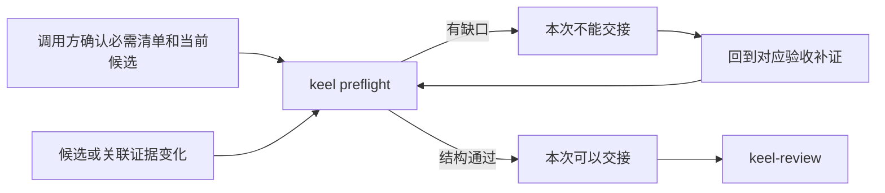
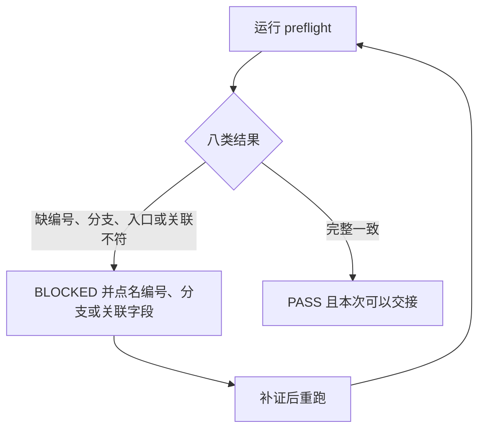
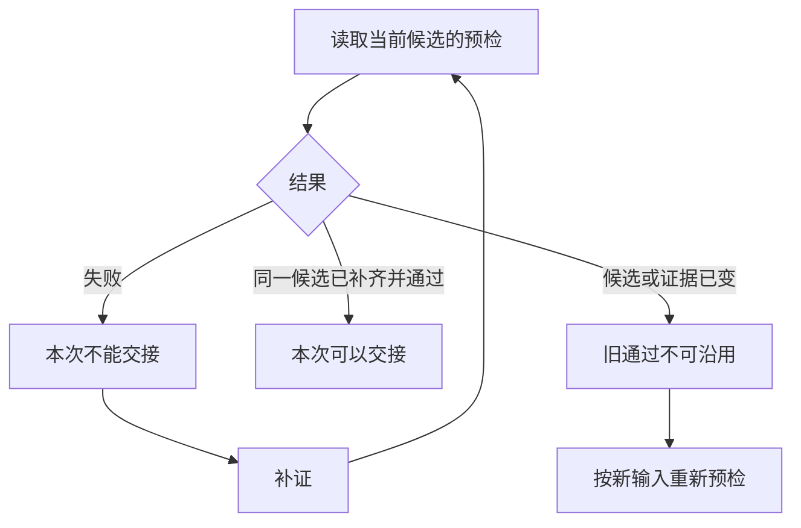

# 送审前证据预检：产品设计

版本：v1。状态：Draft。L1：write。L2：write，见 [technical.md](technical.md)。

确认来源：GitHub Issue [#26](https://github.com/xforce-io/keel/issues/26) 正文（2026-10-05）。本会话「端到端完成」沿用该基线，没有新增入口、范围或验收。

## 1. 背景与目标

编号和文件摘要已经齐，仍可能缺一条验收分支、一个入口，或把旧版本、别的任务、另一份决定接到当前候选上。这类缺口若留到独立审查末尾才发现，补证和补审都会变贵。

目标：在交给 `keel-review` 之前，用调用方单独确认的必需清单，对当前候选做一次只读预检。缺编号、缺分支或阶段收尾、缺入口、声明关联对不上时，逐项写出失败位置。齐了才允许把这份结果放进交接材料。

## 2. 范围与非目标

做：送审前的只读预检；必需编号、分支或阶段收尾、入口；证据文件摘要；声明的任务、产出对象、版本、导出摘要、正式决定请求和修订；`keel-verify` 到 `keel-review` 的交接责任；可运行样例。

清单和规则来自调用方。同一命令接受 L1.8 编号，也接受沿用已有契约的编号。不把某个项目的任务类型或固定编号表写进工具。

不做：补审范围优化、通用失败分类、续跑状态管理；新的交付阶段；工作流引擎、数据库或后台服务；自然语言判真、自动认证人类决定、实际试玩或模型运行、自动判断历史证据是否仍然适用、平台采集、合入。版本适用性只检查调用方有没有声明，对不对仍由独立判断。不修改 `keel check` schema v1。

## 3. 用户与产品概念

角色是 coding-agent、开发者和 reviewer。调用方是准备交接的人，不是待检索引自己。

验收编号、分支或阶段收尾、入口由适用产品基线或沿用契约事先确认。证据声明记录当前候选上每条编号对应的任务、分支、入口、对象、版本、导出摘要、决定、修订和证据文件。预检比较这两份声明，并核对证据文件还在、摘要没变。

## 4. 产品交互总览



对应 S1、S2。结构通过只表示编号、分支、入口和声明关联核对过了。

## 5. 信息架构与入口

命令：

```text
keel preflight RECORD --issue N --candidate SHA --required REQUIRED [--previous PREVIOUS] [--json]
```

`REQUIRED` 是调用方的必需清单，`RECORD` 是证据声明。相对证据路径以 `RECORD` 所在目录为准。没有图形页面。空清单、读不到的文件和非法字段进入错误结果，退出码 1。命令行缺参数退出码 2。通过退出码 0。

帮助入口：`keel preflight --help`。

## 6. Stories 与完整交互

### S1. 送审前发现缺环与错配

角色：coding-agent、开发者。前置：必需编号、分支或阶段收尾、入口已经从基线或沿用契约独立确认，并已取得当前候选和证据声明。触发：`keel preflight`。操作：查看逐项缺口；补齐或改正后重跑。成功：八类结果都有明确输出，文本和 JSON 结论相同，证据文件和候选不被修改。异常：缺什么就失败，不把结构通过写成交付批准。



单步命令，分支在结果类型上。图对应 S1.A1–S1.A9。

### S2. 用预检结果交接独立审查

角色：coding-agent、reviewer。前置：开发和真路径验证已经取证。触发：准备从 `keel-verify` 交给 `keel-review`。操作：读当前候选的预检结果。失败则回到对应验收补证，补齐后重跑再交接。候选或关联证据变了，旧的通过结果不能直接拿来交接。



图对应 S2.A1–S2.A5。两种跨阶段样例走同一命令：失败返工链必须带上人类接受与关闭；操作记录必须对上当前导出版本。

## 7. 产品规则与边界

R1. 必需清单只来自调用方。工具不从证据声明反推「应该有哪些编号」。

R2. 预检只读。它不改证据、不改候选、不执行声明里的命令。

R3. 退出码 0 和「本次可以交接」只表示结构与关联检查通过。`product_acceptance` 恒为 false。它不生成运行事实，不批准交付，不代替 `keel-review` 或 `keel check`。

R4. 一次通过只绑定当时的候选和关联证据。候选变了，或证据文件、声明的对象、版本、摘要、决定、修订变了，旧通过不能沿用。失败的旧结果本来就不是通过；补齐后的新运行可以交接。

R5. 编号写什么由调用方决定。分支与阶段收尾用同一份名称清单表达，工具不解释名称含义。

## 8. 验收与效果验证

每行必需。入口都是 `keel preflight`。主要功能文件：`.agents/skills/verify-keel/features/evidence-preflight.md`（S1–S2）。

| ID / 规则 | 前置和入口、操作 | 可判定结果及禁止结果 | 证据 / 执行 |
|---|---|---|---|
| S1.A1 / S1 / R1 | 清单有两个编号，证据只有一个；JSON 与文本各跑一次 | 失败点名缺少的验收编号；不通过 | CLI 原文；agent 可执行 |
| S1.A2 / S1 / R5 | 编号在，缺一个必需分支或阶段收尾 | 失败点名该编号和该分支 | CLI 原文 |
| S1.A3 / S1 / R5 | 编号在，缺要求的入口 | 失败点名该编号和入口字段 | CLI 原文 |
| S1.A4 / S1 / R1 | 证据上的任务标识与清单不一致 | 失败点名 `task_id` | CLI 原文 |
| S1.A5 / S1 / R4 | 分别改对象、版本、导出摘要 | 每次失败点名对应关联字段 | CLI 原文 |
| S1.A6 / S1 / R4 | 分别改决定请求、修订 | 每次失败点名对应关联字段 | CLI 原文 |
| S1.A7 / S1 / R2 | 证据文件缺失，或摘要与文件不符 | 失败点名 `evidence.sha256`；文件内容不被改写 | CLI 原文与调用前后文件字节 |
| S1.A8 / S1 / R2 / R3 | 完整一致输入；连续跑两次；声明里放一条命令 | 两次退出码 0 且输出相同；文本与 JSON 结论相同；不出现交付批准用语；命令未执行 | CLI 原文与目录字节 |
| S1.A9 / S1 / R5 | 一份 L1.8 编号清单，一份沿用契约编号清单 | 两次都按所给编号判定；缺的编号被点名 | CLI 原文 |
| S2.A1 / S2 / R3 | 有分支缺口 | `ready_for_review` 为 false，文本为本次不能交接 | CLI 原文 |
| S2.A2 / S2 / R3 | 同一候选补齐缺口后重跑 | `ready_for_review` 为 true，文本为本次可以交接 | CLI 原文 |
| S2.A3 / S2 / R4 | 保存一次通过；改变候选或证据后再带上旧输出 | 旧通过使本次失败并点名变化的关联字段；不带旧输出的新运行可以通过，且 binding 不同 | CLI 原文 |
| S2.A4 / S2 / R5 | 样例只留新版检验，清单要求失败、返工、新版检验、人类接受与关闭 | 失败点名 `human-accept-close`；补齐后通过 | CLI 原文 |
| S2.A5 / S2 / R4 | 样例把操作记录标成旧版本 | 失败点名 `version`；改为当前版本后通过 | CLI 原文 |

长期是否减少补审轮次，不作为本次通过条件。

## 9. 折衷与开放问题

分支和阶段收尾共用调用方给出的名称清单。Issue 把二者写成同一类缺口，工具不另造阶段类型。

没有未决的主路径、范围或必需验收。`--previous` 只比较调用方拿来的上一次输出，不保存续跑状态。
