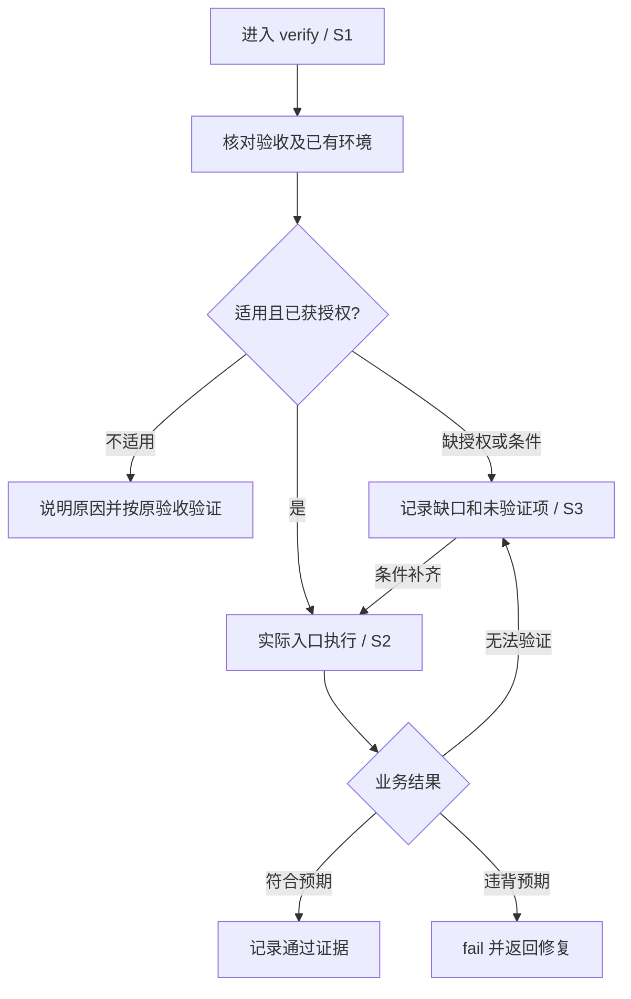

# #27 利用已有测试环境验证实际业务路径

版本：v1。范围来源：本次会话确认聚焦“主动利用已有测试环境”，在两票更新后要求“OK，端到端完成”。Issue：[27](https://github.com/xforce-io/keel/issues/27)。L1 摘要放 Issue；本文按项目要求承载详细契约，产品行为见 §4、§9，L1.8 验收语义映射到 §11，不另建重复正文。

## 1. 背景

已有 Unit 或模拟验证通过，不意味着已检查实际业务路径。当前 verify 从手册定位开始，缺少对会话环境的主动核对。

## 2. 名词解释

沿用[名词表](../glossary.md)，无新增术语。

## 3. 目标与非目标

主动使用适用且获授权的已有环境，依据业务结果判定。非目标：生产环境默认访问、自动补手册、扩展 check、通用模型评测框架。

## 4. 能力

S1：进入 verify，读取验收与会话/项目中的环境信息，交代适用性与依据；已有信息不重复索要。无相关环境时按原验收条件执行，不虚构地址或凭据。

S2：环境适用且条件满足时，执行实际入口，记录候选版本、环境、业务响应及必要下游结果。外层成功但业务失败为 fail，不因 Unit 通过省略实测。

S3：缺凭据或认证拒绝导致预期业务无法验证时为 blocked，说明尝试/缺口与下一步。恢复后重验同一 ID，保留原记录。认证失败本身是验收预期时，依合同判定。

### 4.1 UI/UX

沿用会话入口与验证完成表，无新增页面。主路径为环境判断→实际执行→证据结论；空状态说明没有适用环境，错误状态保留未验证项，成功状态给出实际业务证据。

图覆盖 S1.A1/A2、S2.A1/A2、S3.A1/A2/A3。

## 5. 思路与折衷

把环境核对作为 verify 的准备动作，不建立新的环境登记系统。手册提供操作路径，合同决定证明对象，会话可补充环境事实。放弃“有任意环境就必须连接”和“手册只写模拟就忽略环境”两种极端。

## 6. 架构

路由仍交给 verify；verify 消费产品基线、环境事实和项目手册，产出逐项证据；review/release 沿用原始证据核对。失败沿原有 fail/blocked 返回，范围调整沿既有确认规则。

## 7. 模块

N/A：仅调整 keel-verify 行为条款及本仓库对应验证条目，无新增产品模块。

## 8. API/CLI

N/A：不改变公开 CLI、schema 或工具接口。

## 9. 边界

适用性包含验收相关性、服务/数据、版本与权限边界。提供地址不等于授权部署或破坏性操作。手册路径与实际环境冲突时说明缺口并按原规则处理，不静默退回模拟或降低验收。证据不包含密钥明文。实测失败不被模拟结果覆盖。

## 10. 迁移/兼容/回滚

既有功能地图与证据格式继续使用；按需补充本次环境事实，不批量迁移历史任务。回滚为撤销本票 skill 变更，无数据迁移。

## 11. 测试计划

主要功能文件：[provided-environment.md](../../.agents/skills/verify-keel/features/provided-environment.md)。下列全为必需，使用安装后的 skill 驱动独立 agent 执行受控场景。保存输入、轨迹、命令/请求日志、结论、宿主/模型、候选 SHA 与时间。受控服务证明规则执行行为，不宣称已验证某个外部业务系统或所有模型。

| ID | 前置与入口 | 可判定结果/禁止结果 |
|---|---|---|
| S1.A1 | 已提供适用服务；进入 verify | 识别环境并实际使用，不重复索要 |
| S1.A2 | 提供与验收无关环境；进入 verify | 说明不适用依据，不强行连接 |
| S2.A1 | Unit 通过且服务业务成功；执行实际入口 | 仍发起业务请求并核对结果，pass 有业务证据 |
| S2.A2 | 外层命令 0、业务失败 | 不把外层成功写成通过，业务项 fail |
| S3.A1 | 必需项缺凭据 | blocked，说明缺口，不造凭据或写成 skip |
| S3.A2 | 凭据被拒而无法执行预期业务 | 保留尝试及拒绝证据，blocked |
| S3.A3 | 补齐 S3.A1/A2 的条件 | 同一验收 ID 重新执行，更新结果且保留受阻记录 |

E2E：以上 7 项的 agent 执行与实际受控服务记录。Integration：scratch install/doctor，验证引用及挂载可读。Unit：现有 unittest 回归，不以字符串断言替代 E2E。

## 12. 开放问题

无影响当前范围的未决产品问题。模型行为验证只覆盖记录中的宿主及场景。

## 13. 关联

- [#28](https://github.com/xforce-io/keel/issues/28)：修复前复现与调查，独立交付。
- [#26](https://github.com/xforce-io/keel/issues/26)：证据结构预检，不在本票实施。
