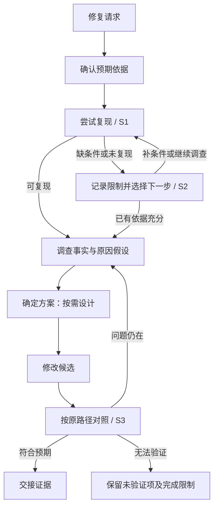

# #28 修复任务先复现再定方案

版本：v1。范围来源：本次会话逐项讨论后，用户在更新 #28 后要求“OK，端到端完成”。Issue：[28](https://github.com/xforce-io/keel/issues/28)。L1 摘要放 Issue；本文遵循项目 13 节结构，产品行为见 §4/§9，L1.8 验收语义映射到 §11，不另建重复正文。

## 1. 背景

仅要求修改代码前复现，仍允许先凭猜测定方案。修复任务应让观察及调查约束方案选择，设计文档是否必要不改变此顺序。

## 2. 名词解释

沿用[名词表](../glossary.md)。复现证明现象，调查形成原因判断依据，二者不能互相代替。

## 3. 目标与非目标

确认预期→复现与调查→确定方案→修改→对照验证。非目标：新增阶段、两套完整 playbook、按设计文档重新分类 bug/feature、通用评测框架。

## 4. 能力

S1：修复任务进入 how 时，先确认预期，尝试从原入口复现；结合源码/日志/诊断实验区分事实与假设，产出能约束方案的依据，再进入按需设计或实现。是否写设计文档不改变顺序。

S2：缺条件与已执行但未复现分别报告。列出已有替代证据、未确认判断、下一步理由；可继续调查或据充分依据修复，不能因一次未复现宣称不存在，也不要求无限重试。

S3：候选修复后以相关条件可比的原路径对照。成功有前后证据，仍失败返回调查，无法执行明确未验证项；不把输入或环境改变当成修复效果。

### 4.1 UI/UX

沿用会话和现有环节交接，无新页面。空状态为缺复现条件/未复现，错误状态为仍偏离预期，成功状态为有据方案及对照结果。

覆盖 S1.A1/A2、S2.A1/A2、S3.A1/A2/A3。

## 5. 思路与折衷

复用 how 在方案前理解问题的位置，为修复任务允许受控运行时观察；非修复任务仍为源码说明。放弃在 dev 才第一次要求复现，因为 design 可能已确定方案；也放弃新增复现阶段和复制全部交付流程。

## 6. 架构

路由只安排 how 在设计/开发前，不复制复现规则。how 拥有复现调查合同；design/dev 消费它，缺依据退回 how。verify 拥有修复后对照结果。问题仍在退回 how，后续沿原流程；审查证据真实性规则不变。

## 7. 模块

keel：修复任务不能以普通 how skip 绕过调查。keel-how：源码与运行时事实。keel-design/keel-dev：引用证据后定方案或实现。keel-verify：对照并回流。规则正文各归所属环节。

## 8. API/CLI

N/A：无新命令、参数、schema 或角色。

## 9. 边界

读取源码、准备环境、加临时诊断和可撤回实验允许服务于调查，不视为已确定产品修复。how 不提交产品修复、不写 L1/L2、不代替最终验收。已有同一问题、适用版本及条件的证据可复用，但“已讲机制”“单模块”不能代替复现记录。环境操作仍受授权约束，诊断不得破坏用户数据。有限尝试后说明下一步，无无限复现要求。

## 10. 迁移/兼容/回滚

保留七环节及已有 how 三种 skip 名称，为修复任务增加适用条件；旧记录足够时复用，不补造历史证据。回滚撤销本票 skill 变更，无存储迁移。

## 11. 测试计划

主要功能文件：[reproduce-before-fix.md](../../.agents/skills/verify-keel/features/reproduce-before-fix.md)。全部必需；通过独立 agent 对临时项目实际执行，保存输入、原始轨迹、修改顺序、命令输出和结论，附宿主/模型、候选 SHA 和时间。

| ID | 前置与入口 | 可判定结果/禁止结果 |
|---|---|---|
| S1.A1 | 有设计需求的可复现 CLI bug；进入 how→design | 原入口复现与原因调查先于方案确定，不凭“需要设计”跳过 |
| S1.A2 | 无设计需求的可复现单模块 bug；进入 how→dev | 不因单模块 skip 丢失问题证据，方案引用调查 |
| S2.A1 | 缺必要环境；进入 how | 明确缺口/替代依据/假设/下一步，不造复现 |
| S2.A2 | 已执行但未复现；进入 how | 留存实际输出，不宣称不存在，不无限重试 |
| S3.A1 | 修复候选正确；进入 verify | 可比原路径前后证据支持 pass |
| S3.A2 | 修复候选仍错；进入 verify | fail 返回调查/修复，不以 Unit 通过放行 |
| S3.A3 | 原路径无法运行；进入 verify | 保留证据缺口与对完成判定的影响，不宣称对照通过 |

E2E：以上 7 项行为与工具执行顺序。Integration：scratch install/doctor 与跨环节引用可读。Unit：现有 unittest 回归；不以规则关键字替代行为证据。不保证一次验证证明所有模型长期遵守。

## 12. 开放问题

无未决产品范围。how 的运行时权限仅限调查用途，是落实已确认顺序的环节分工。

## 13. 关联

- [#27](https://github.com/xforce-io/keel/issues/27)：已有环境用于验证，独立交付。
