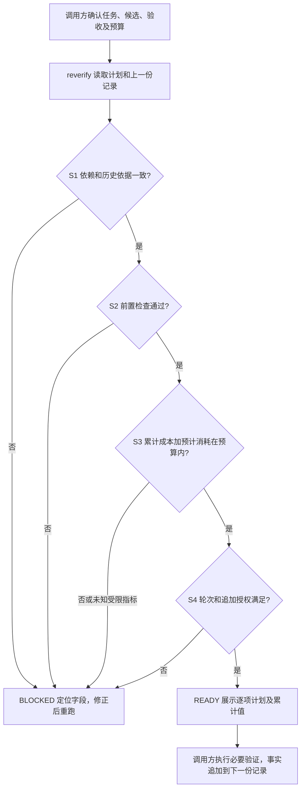

# #31 复验范围与运行成本

Draft v1。L1 概要在 [Issue #31 的 v1 评论](https://github.com/xforce-io/keel/issues/31#issuecomment-6309301334)；确认来源为用户先要求详细开票，再明确“端到端完成 keel #31，注意控制时间和 token，独立 review PASS 后提 PR 并合入”。沿用票中 S1–S4 和全部定量验收，不自签 Approved。

形式按本会话 AGENTS：L1 评论/Issue 摘要；L2 为本文件、13 节。§4 定义命令交互，§11 为产品验收细化及技术验证映射；不另复制一份详细设计。L1: write；L2: write。

## 1 背景

现有 `bin/keel::commandCheck` 只检查发布前 schema v1 和原始文件摘要；`keel-verify` 要求按影响范围驾驶，`keel-review` 要求新候选重证及三轮交人。缺少复验准备的可执行核对，调用方容易把新 SHA 视为全部业务重分析。原任务的失败、耗时及计量缺口见 Issue，复现不依赖私有业务文件。

how 依据：`bin/keel::buildParser` 原先只有 install/uninstall/doctor/check；实际 `reverify --help` 退出 2，原输出留在本任务本地验证目录。`commandCheck` 不运行证据命令，安装把 `skills/` 整目录挂载或复制，副本 CLI 通过 `State` 找回 source；复用这些机制，不修改旧 check 合同。

## 2 名词解释

沿用 [名词表](../glossary.md)。新增“复验计划”“运行记录”，不将 READY 称作验收 PASS。

## 3 目标与非目标

目标：当前候选的重跑/历史依据、确定性前置检查、可得累计成本和追加审查边界可检查；已有授权且预算内不重复询问。

非目标：调度/执行测试或模型、自动认定依赖完整性或授权真实性、代替实际用户路径/正式审查、变更 check v1、自动合入、计价服务、修改其他项目。

## 4 能力

`keel reverify RECORD --task TASK --candidate SHA --baseline SHA --items IDS --prechecks IDS --root DIR (--initial | --previous FILE) [--changed-path PATH] [--require-agent ID] [--json]`。

调用方从任务、Git 变更和产品基线独立取得参数，不能从待检结果反推期望。初次空状态提供 `--initial` 和空 history；后续提供原始上一份记录。读取失败、缺字段、摘要或版本不符、非法保留、前置失败、预算不足、历史清零或轮次用尽均为 BLOCKED/退出 1；命令行错误为 2。成功 READY/退出 0，输出逐项决策、累计用量和语义边界，不执行任何计划。修正输入或补原始证据后重跑，无写操作，不需要保存/取消页面。

S1–S4 共用交互（各异常分支分别覆盖，不用技术架构图替代）：

图对应 §11 的 S1.A1–S4.A1。READY 不代表 H 已发生。暂停不触发执行；恢复仍沿用任务标识、上一份记录和预算。

### 4.1 UI/UX

无图形界面。文本入口先显示 READY/BLOCKED，再显示每项 decision/method/reason、累计值及限制；JSON 同结论。错误定位输入字段，保留可修正反馈；无记录不能默认为成功。

## 5 思路与折衷

用单次只读核对代替新工作流引擎。依赖清单及影响范围由调用方声明，工具核对当前文件摘要、声明前后值和必要项，无法自动判断漏报的语义依赖；独立审查仍核对完整合并差异及声明真实性。保留历史原始证据及原 SHA，当前核对事实与其分开，不伪装新运行。昂贵 Agent 仅在相关依赖变化、无历史依据或合同明确要求时安排；确定性及实际路径可按需重跑。完整必需验收不能借增量范围逃避。

不做计价、后台监控或强制杀进程；工具只检查下一批预计成本是否能启动，实际宿主计量、预算内取消和真实性由调用方负责。缺少 token 计量时用显式时间/调用预算，不能在 token 限额下伪造已知零。

## 6 架构

分层：`bin/keel` 参数及既有 source 定位 → 随 keel-verify 分发的标准库脚本 → 本地 JSON/文件摘要。主路径见 §4；任何检查失败返回 BLOCKED，不接平台、不执行输入内命令。只有安装来源中的可信模块被加载，不执行记录声明的代码。

## 7 模块

复验脚本负责结构、依赖、证据、历史及预算检查；keel-dev 负责先收敛同类边界；keel-verify 负责计划及当前候选的真实路径；keel-review 保留完整独立审查和轮次门禁。每份规则只写所属 skill，详细输入说明集中在 reverify reference。

## 8 API/CLI

schema_version=1，独立于发布 check 的 schema v1。完整字段及示例见 [输入合同](../../skills/keel-verify/references/reverification.md)。只接受至多 1 MiB 的 JSON 对象，拒绝重复键、非有限数、错误类型。依赖文件限制在 --root 内，缺失文件以 null 表达新增/删除；记录不能凭空引入不存在的依赖作为保留证明。

items 与独立 --items 编号、顺序一致；前置检查与 --prechecks 一致。每项明确方法、依赖前后摘要、决策、理由；保留须有原始运行 SHA 的证据和当前依赖一致核对；原运行可早于 baseline，不能强制重标最新版本。--require-agent 明确本候选必须实跑的项目，不能 retain。

history 以稳定 task_id 和运行 id 累计，--previous 的 history 必须是当前 history 的完整前缀。CLI/原子读取/上游请求独立计量。token nullable；模型调用全零 usage 转未知，cached 不大于 input。limits 至少包含时间和模型调用数；受限指标未知或累计+预计超限均阻断。放宽/移除旧预算限制须有 actor 和原始授权证据。根目录、依赖或前置条件失败仍展示已可计算的累计/限额/计划/预计；聚合溢出标 null 并阻断，输出须为标准 JSON。

审查在同一任务累计，默认 3 轮；追加授权记录 after_round、additional_reviews、actor、证据，连续扩展实际边界，不能重复使用同一边界扩额；previous.extensions 必须作为不可变前缀保留，不能覆写其额度、主体或引用。继承授权的相对证据按 previous 目录解析，新增按当前记录目录；连续移动保留上一目录证据，或在首次引用时使用绝对路径。失败后追加昂贵运行必须有根因、策略变化和退出条件。授权来源、依赖完备性、统计真实性仍由人/调用方/正式审查核对，不能认证签字。

## 9 边界

首次输入不能包含历史；已有任务必须提供原始上一份记录，工具不能从新文件名或自报 task_id 认证真实历史。调用方不得以 --initial 隐藏已发生的运行。READY 不是永久凭证：候选/依赖/证据/预算使用变化后重新核对。不得把保留依据计作当前已执行，输出 executed=false。

## 10 迁移/兼容/回滚

旧 check 索引、已有安装命令和门禁兼容。脚本随既有 skill 复制机制分发；复制安装从 State 找 source。回滚本分支新增入口及相关引用即可，无用户数据迁移。真实家目录、共享 checkout 脏文件与 energy-cli 均不修改。

## 11 测试计划

以下全部必需；前置均为隔离目录、合成文件、当前 checkout/scratch 安装，Python≥3.11，无平台业务依赖。主要功能文件统一为 `.agents/skills/verify-keel/features/reverification.md`。不要求另一次医院分析或新独立 Agent 业务评估；正式独立代码审查仍必需。

| ID / Story | 实际入口与操作 | 可判定结果及禁止行为 | 证据 / 层级 |
|---|---|---|---|
| S1.A1 / S1 | CLI 三类变更及 --require-agent；改当前文件/旧证据/未覆盖路径 | 3 类决策解释完整，相关和必需项 100% 覆盖；无影响的重复 Agent 为 0；不改旧 SHA | 原始输出、文件摘要与逐项 actions；E2E CLI/Integration |
| S2.A1 / S2 | 三类最小契约失败注入到真实 CLI 前置检查；修正再运行 | 失败先阻断，修正 READY；不启动模型，不称审查 PASS | 三类可执行样例、状态及输出；Unit/Integration/E2E CLI |
| S3.A1 / S3 | 预算内/边界/未知计量/追加四路径 | 累计与预计可核对，未知不补零，预算边界阻断；不逐次要许可 | 原始输入/输出、限额及已知/未知字段；E2E CLI |
| S4.A1 / S4 | 三轮/暂停恢复/追加一轮；新候选和新文件名尝试清历史 | 3 条路径保留历史/成本及授权引用；非 PASS 不放行发布 | 原始 previous/当前输入、输出；E2E CLI |

Integration 验证 check 旧套件和复制安装的帮助、READY/BLOCKED/doctor；Unit 覆盖非法 JSON、目录约束、预算类型、历史追加与三类失败契约。文件摘要只证明内容一致，不证明作者或业务正确。正式 code review 是本次发布门，不属于上述样例签出的结果。

## 12 开放问题

影响本次闭环的问题无。跨宿主精确 token 计量不可保证，以 null 及时间/调用预算退路处理。真实项目长期降耗比例为后续观察，不能从合成样例宣称已节省固定百分比。

## 13 关联

[#31](https://github.com/xforce-io/keel/issues/31)、[#26](https://github.com/xforce-io/keel/issues/26)（结构缺环预检仍独立）、[#20](https://github.com/xforce-io/keel/issues/20)（发布门兼容）、[#28](https://github.com/xforce-io/keel/issues/28)（先取依据再修复）。PR 创建后在该 PR 引用本文件和 Issue，不另存副本设计。
