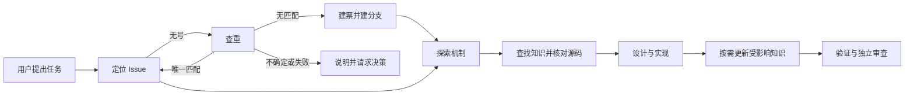

# 项目知识与无号任务：产品设计

版本：v1；状态：会话确认范围，待交付审查。Issue：[33](https://github.com/xforce-io/keel/issues/33)。确认来源：本会话用户认可项目知识方案、要求端到端实施，并明确要求缺号先查重、无重复则新建。L2：[technical.md](technical.md)。

## 1. 背景与目标

复用可核对的项目机制知识，减少重复探索；无 Issue 编号时查重并继续，不无谓中断交付。

## 2. 范围与非目标

覆盖任务相关知识发现、源码核对、沉淀建议、开发中维护和审查；覆盖无号交付的查重、复用、建票与继续。不是全项目自动采集、独立知识服务或改变合入/发布门禁。

## 3. 用户与概念

用户向 agent 提交任务；项目知识是项目内可复用的机制说明，设计意图和当前实现分开；术语以项目名词表为准。

## 4. 产品交互总览

## 5. 信息架构与入口

沿用 keel 的任务入口、项目现有文档与有效 AGENTS.md；没有约定时机制说明可放 docs/knowledge/。无需初始化；直接调用 keel-how 仍只读。单独请求建票仍建完停止。

## 6. Stories 与完整交互

- **S1 查找和核对**：任务进入 how，按任务范围读相关知识和源码；知识缺失时探索，冲突时分别报告设计意图和当前实现及出处；源码不足以说明时 BLOCKED。无需加载全库。
- **S2 沉淀维护**：how 对值得复用的跨模块机制提出带位置的具体建议，不自行写；dev 在授权任务范围内维护因实现变化失效的知识，按现有项目约定优先；review 核对本次相关知识与实现，不做全库巡检。没有复用价值不强制新增；无关缺口报告而不扩大范围。
- **S3 无号交付**：用户要求处理、设计、开发或端到端但未给号码，识别平台并查开放及相关近期关闭票；唯一明确同一需求则复用，未找到则按建票合同建票、建分支并按原模式继续；多个可能匹配或需求不足以判断时问用户；查重失败、认证失败或建票失败则 BLOCKED，不假称无重复。显式指定号码直接定位。仅建票请求建完停止；显式用户限制优先。

## 7. 产品规则与边界

R1 文档是定位线索，相关行为以当前源码核对，保留设计与实现差异。R2 项目既有约定优先，默认文件不强制；不保存秘密或无依据推测。R3 未确认重复时不得重复建票；查重成功与零结果须区分。R4 既有验收、分支、验证、审查及发布门禁不变。

## 8. 验收与效果验证

每行必需；由 agent 在真实 skill 入口执行，留命令、输入、结果和源码/文件证据；不得用静态文本或模拟结果冒充真实会话。主要功能文件：`.agents/skills/verify-keel/features/project-knowledge.md`（S1–S3）。

| ID / 规则 | 前置和入口、操作 | 可判定结果及禁止结果 | 证据 / 执行 |
|---|---|---|---|
| S1.A1 / R1 | 相关知识存在；从 keel-how 任务入口探索 | 找到相关资料、核对本次源码并引用；不加载全库 | 会话记录和引用；agent 实跑 |
| S1.A2 / R1 | 知识缺失或与源码冲突；同入口 | 缺失时探索；冲突分别说明并引用；不足时 BLOCKED | 两种场景记录；agent 实跑 |
| S2.A1 / R2 | 存在可复用机制或简单一次性事实；how | 前者给具体更新建议，后者不强制建文档；how 不写 | 工作区 diff 与记录；agent 实跑 |
| S2.A2 / R2 | 实现改变已记录机制；dev、review | 更新受影响文档并审查一致性；不复制其他事实源 | 变更及审查记录；agent 实跑 |
| S3.A1 / R3–R4 | 无号、唯一明确匹配；keel 任务入口 | 复用且按原模式继续，不建重复票 | 查询与会话记录；agent 实跑 |
| S3.A2 / R3–R4 | 无号、查重成功且无匹配 | 创建一票、合法分支并按原模式继续；独立建票仍停 | 真实隔离 tracker 或经授权平台记录；agent 实跑 |
| S3.A3 / R3 | 多个候选或查重/创建失败 | 歧义问人；失败 BLOCKED，不建重复票、不假报成功 | 会话及 tracker 状态；agent 实跑 |
| S3.A4 / R4 | 用户指定号或只请求建票 | 指定号直接定位；仅建票建完停 | 会话与 tracker 状态；agent 实跑 |

长期效果（重复探索减少）交付后观察，不作为本次 PASS 的替代。

## 9. 折衷与开放问题

查重可能遇到语义歧义，宁可询问也不自动猜。不同项目的知识路径遵从其现有约定。无影响主路径的未决产品问题。
