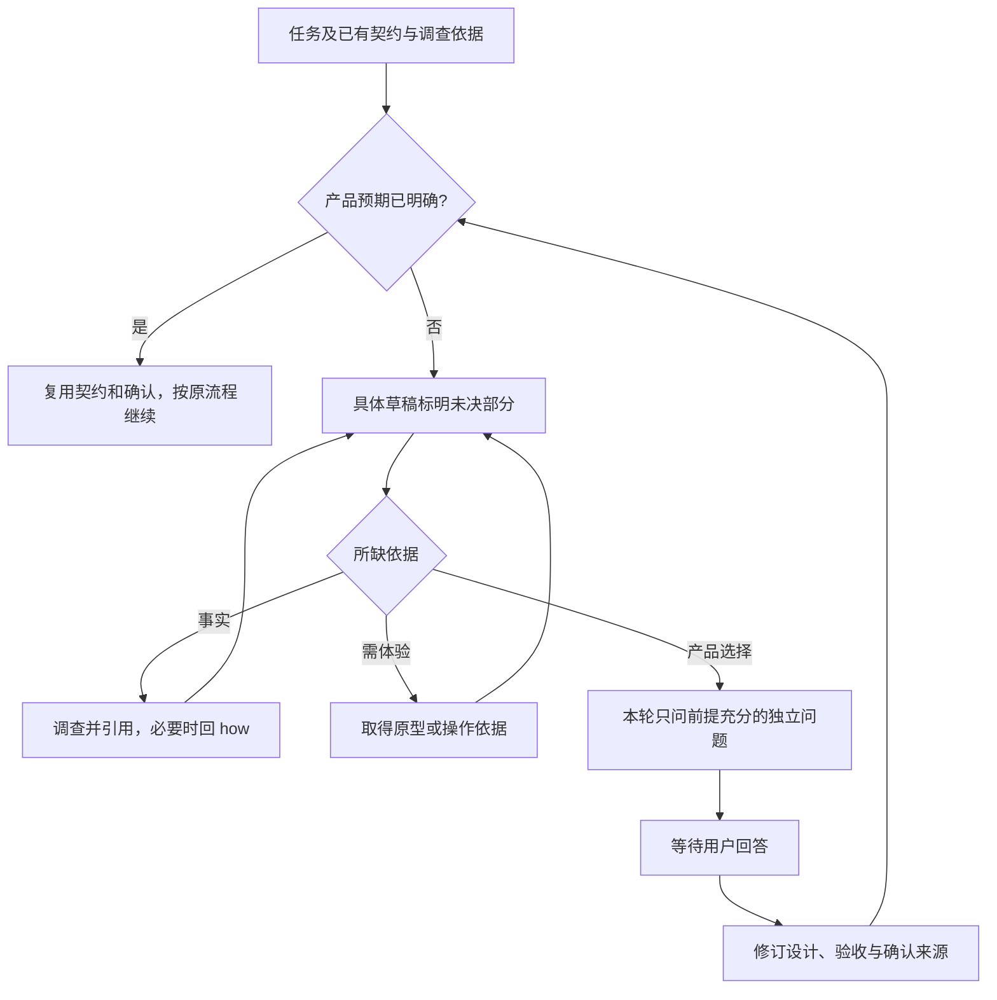

# L1 产品设计：按需澄清产品取舍

版本：v1；状态：Draft，范围依据见下文，不能代替独立审查。Issue：[35](https://github.com/xforce-io/keel/issues/35)。

L1：write，改变设计会话行为；L2：skip，沿用现有 Markdown skill、引用、安装及验收机制，无新增技术接口或存储契约。本票沿用 [#24 产品设计](../24-product-technical-design/product.md) 已采用的 L1 产品/L2 技术定义；与旧概要/详细标题的冲突按既有设计合同显式映射，不修改用户全局指令。

确认依据：本会话先交付更新后的具体方案，用户追问小 bugfix 后，要求“端到端完成设计开发 review，并完成验证，后pr”。采用其中已讨论的按需澄清、依赖分轮、回答保留及明确契约小修复直接复用范围，不将该指令扩展为合入授权。后续若新增产品取舍，仍须按原确认规则处理。

## 1. 背景与目标

keel 已规定产品基线和验收，但未定义怎样从具体草稿发现并澄清未决产品选择。本票让用户只回答确需其决定的问题，回答完整进入原有契约，小修复不承担无效访谈成本。

现状依据：[设计 skill](../../../skills/keel-design/SKILL.md) 负责草稿与交接；[确认规则](../../../skills/keel/references/when-to-ask.md) 控制确认来源和推进；[how](../../../skills/keel-how/SKILL.md) 核对项目知识及源码、保持只读；[设计合同](../../../skills/keel-design/references/design-contract.md) 定义产品路径和 L1.8。现有合同已覆盖决定的去向，无须新增知识台账。

## 2. 范围与非目标

覆盖按需澄清的触发、依赖分轮、推荐及代价、事实/体验缺口、回答落点及变更后的核对。沿用用户所选流程的停点。

不新增交付环节、独立 grill skill、CLI、schema、ADR 或决策台账；不改 how 职责、操作授权、产品确认或发布门禁；不带入另一工作区的 Story 交互图增强。

## 3. 用户与产品概念

用户决定未明确的产品取舍，coding-agent 查事实、形成草稿并维护对应设计与验收。已有术语见 [名词表](../../glossary.md)；本票没有新增规范术语。

## 4. 产品交互总览

## 5. 信息架构与入口

沿用 keel-design 和原小修复路径。设计 skill 指向按需读取的澄清参考；没有未决产品选择时不加载访谈。无新页面、命令或初始化。用户可以纠正范围、回答不知道、选择逐题交流；不知道不等于接受推荐。

## 6. Stories 与完整交互

- **S1**：进入任务，复用已有确认及 how 依据；能查明的事实自己查。已有契约充分的小 bugfix 直接沿用设计与验收，调查/验证仍按原规则。真正未决的产品结果在可评审草稿中标注，不能填成已确认；请求明确预期时只澄清受影响部分。成功为已知与未决分开、没有无效访谈；事实无法取得时明示缺口而非猜测。路径为 §4 的 E→K→R，或 E→K→D→F→H/Q；对应 S1.A1–A3。
- **S2**：围绕入口、路径或规则按编号问本轮独立问题，每题给具体选项、推荐及主要代价。依赖本轮未回答选择的问题延后，回答后重算下一轮。等待期间可查独立事实，但不能替用户决定。需要体验的选择取得原型或实际操作依据后再讨论；条件缺失则保留未决，其他独立部分继续。路径为 §4 的 D→F→Q→U→W→K 及 F→P→D；对应 S2.A1–A2。
- **S3**：用户回答后更新原有设计对应段落与适用验收，不用摘要弱化精确约束。上游改变时核对下游路径、规则和验收，保留修订对应及确认来源，受影响部分按原规则确认；未变部分直接复用。路径为 §4 的 U→W→K→D/Q，关联 S3.A1–A2。
- **S4**：隔离安装后从 library 中的设计 skill 读取参考和确认合同，执行上述代表性会话。缺引用或越过未决主路径为失败；不把推荐当确认，不新增结束批准。安装/doctor/读取/会话/uninstall 的操作记录构成成功依据。该入口无新增交互分支，沿用 [设计合同入口](../../../.agents/skills/verify-keel/features/design-contracts.md)；对应 S4.A1。

## 7. 产品规则与边界

R1 只在依据不足且不同选择改变产品结果时澄清；小不等于自动免问，大不等于必须访谈。事实和不改变产品契约的技术选型不转嫁给用户。

R2 以依赖分轮，不能把未知答案当已知前提；用户回答、否定或不知道都必须真实处理。上游改变后重审受影响内容。

R3 产品行为归 L1、技术契约归适用 L2、术语归名词表；引用原事实源。无 L1 适用时沿用既有契约，不为留存回答制造新文档或编号。

R4 原确认来源、产品基线与模式停点不变；未决主路径/范围/权限/必需验收阻止进入相关技术设计或实现。没有问题不是自动确认；已有有效确认不重复索取。没有新产品取舍的修复与技术调整按原规则继续。

## 8. 验收与效果验证

主要功能文件：`.agents/skills/verify-keel/features/design-clarification.md`，覆盖全部 S。以下均为必需、agent 可执行；场景使用隔离合成业务，不接生产，真实运行 coding-agent 并提供预先编写的测试用户回复，不能把脚本硬编码输出冒充模型行为，也不能据此推断所有宿主/模型都遵守。

| ID / 关联 | 前置、入口与操作 | 可判定结果与禁止结果 | 证据要求 |
|---|---|---|---|
| S1.A1 / S1 / R1 | 已确认允许 0；真实小 bugfix 入口调查并修复默认值错误 | 无访谈或新设计，复用契约；复现、修复及原路径验证仍完成 | 模型原始会话、依据、diff、前后运行 |
| S1.A2 / S1 / R1 | 源码和已有知识能回答事实；设计入口读取 | 自行读取并引用，不能向测试用户索要可查事实 | 工具调用、来源及问题记录 |
| S1.A3 / S1 / R1/R4 | 失败能否保存未定；设计入口形成草稿 | 草稿标明未决，提出具体取舍，未答前不实现或自批 | 草稿及问答原文、目录 diff |
| S2.A1 / S2 / R2 | 保存选择影响后续执行状态；第一轮回答后继续设计会话 | 第一轮不问依赖未知答案的问题，每题有选项/推荐/代价；第二轮由实际回答解锁 | 至少两轮原始模型输出及测试回复 |
| S2.A2 / S2 / R2/R4 | 布局选择需要操作体验；先缺依据，再提供实际原型或操作记录 | 缺依据不代选；取得依据后再形成决定；独立问题可继续 | 前后会话、可操作原型或真实操作记录及引用 |
| S3.A1 / S3 / R3 | 测试用户答保存、默认自动重试 0、手动最多 3 次、仅管理员、禁止自动执行 | 精确值与否定约束写入原设计和适用验收，不塞进知识文档 | 回答、设计与验收的逐项对应 |
| S3.A2 / S3 / R2/R4 | 延续会话，将允许失败保存改为禁止 | 受影响路径及验收修订，旧值不继续作为有效承诺；来源可追溯，未变范围不重问 | 前后设计 diff、验收修订及会话 |
| S4.A1 / S4 / R4 | 干净候选的 scratch install → doctor → library 设计入口及引用 → 会话 → uninstall | 引用可读；真实会话完成；无新增环节/CLI/schema/批准门；不触及真实 home | SHA、命令原文、退出码、会话及清理记录 |

E2E：上述真实模型会话及小修复前后入口；Integration：隔离安装与引用可达性；Unit：现有合同/安装/check/reverify 回归。长期返工或提问轮数收益只作后续观察，不宣称本票已证明。

## 9. 折衷与开放问题

选择在既有设计阶段按需读取方法，放弃新增强制访谈和决定台账，减少流程与事实源重复。依赖判断仍依靠模型，不能声称已机器证明问题完备；需要用实际会话检验。不存在超出本会话范围的待定产品选择。
