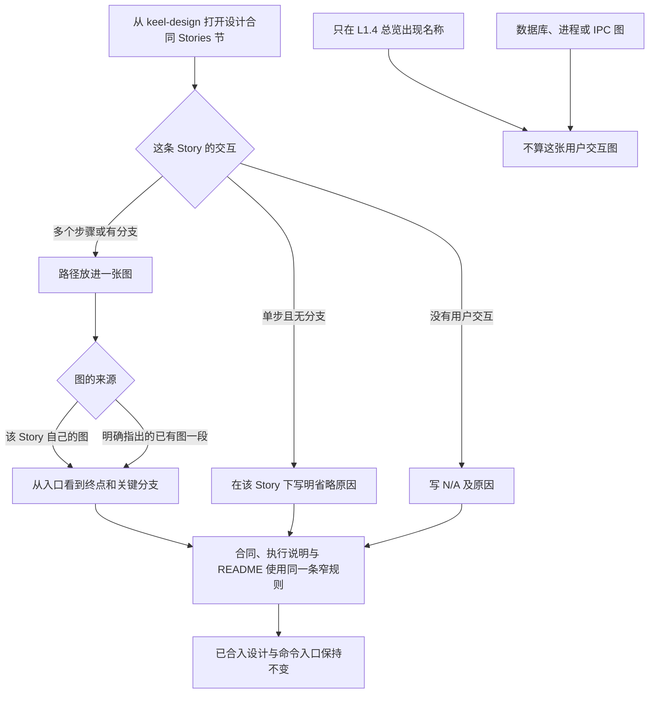

# L1 产品设计：有分支的用户交互路径要能在一张图里看完

版本：v1。状态：Draft。Issue：[38](https://github.com/xforce-io/keel/issues/38)。

L1：write。本票改变设计合同时对 Story 交互图的要求。L2：skip。沿用现有 Markdown skill、安装引用与合同测试，没有新的命令、schema、存储或检查器。

确认来源：本会话。用户追问硬性必须之后，交付范围确定为窄口径：多步骤或有分支的用户交互路径要能在一张图里看完；单步且无分支、以及没有用户交互的纯技术 Story 可以省略；不把「每条 Story 必须提供交互图」写成要求。该句不进入合同。

## 1. 背景与目标

已合入的设计合同在 Stories 节只要求复杂交互另补流程图（`skills/keel-design/references/design-contract.md` 变更前的第 6 节）。总览节另有一张主交互图，并写明那里不画数据库或进程架构。多步骤或有分支的路径仍可能只留在正文里，只在总览里出现 Story 名称也会被当成已经覆盖。

目标是写 L1 时能判定路径有没有被一张用户交互图覆盖，同时允许单步无分支和纯技术 Story 不另画图。

## 2. 范围与非目标

覆盖设计合同 Stories 节、keel-design 执行说明和 README「两层设计」里的同一条窄规则，以及从设计 skill 入口读到它。

不要求每条 Story 各有一张图。不改写已合入的 `docs/design/`。不新增命令、schema 或画图检查器。不处理 #26，不清理残留分支。#35 已声明不带入更严的交互图草稿，本票不恢复那份草稿。

## 3. 用户与产品概念

coding-agent 按合同写或核对 L1。用户评审时能顺着一张图看完有分支的路径。已有术语见 [名词表](../../glossary.md)。本票没有新增规范术语。

## 4. 产品交互总览

## 5. 信息架构与入口

沿用 keel-design。执行说明指向设计合同；Stories 节是这条规则的事实源。README「两层设计」复述同一条，不另定更严或更松的标准。没有新页面、命令或初始化。

## 6. Stories 与完整交互

- **S1**：Story 有多个步骤或有分支时，路径必须能在一张图里看完。图可以是该 Story 自己的，也可以是它明确指出的、已经画出该路径的已有图的一段。只在 L1.4 总览里出现 Story 名称不算覆盖。数据库、进程、IPC 图不能充当这张用户交互图。路径为 §4 的 A→B→C→D→E；不算覆盖的判定是 H→X 与 I→X。对应 S1.A1–A2。
- **S2**：单步且无分支的 Story 在该 Story 下说明原因后可以省略图。没有用户交互的纯技术 Story 写 N/A 及原因。合同、keel-design 执行说明和 README「两层设计」都不要求每条 Story 各有一张图。路径为 §4 的 B→F、B→G 与 R。对应 S2.A1–A2。
- **S3**：从已安装的 keel-design 执行说明进入设计合同 Stories 节，读到与 S1、S2 相同的规则。已合入的设计文档保持不变，命令入口不增加。路径为 §4 的 A→R→K。该入口沿用 [设计合同入口](../../../.agents/skills/verify-keel/features/design-contracts.md) 的安装方式。对应 S3.A1–A2。

三条都引用 §4 里已经画出的路径，不另画重复图。

## 7. 产品规则与边界

R1. 只有多个步骤或有分支的用户交互，才要求路径能在一张图里看完。

R2. 覆盖只认该 Story 自己的图，或它明确指出的已有图的一段。总览里的名称和技术结构图都不算。

R3. 单步且无分支、以及没有用户交互的纯技术 Story，按本节省略。不要求每条 Story 各有一张图。

R4. 三处文案保持同一条规则。历史设计不因本票改写。不新增机器检查来强制画图。

## 8. 验收与效果验证

主要功能文件：`.agents/skills/verify-keel/features/story-path-diagram.md`，覆盖 S1–S3。以下均为必需。合同措辞由直接读取仓库文件的单元测试判定；安装入口由 scratch install 后的设计 skill 摘录判定。不运行模型来代替读到的原文。

| ID / 关联 | 前置、入口与操作 | 可判定结果与禁止结果 | 证据要求 |
|---|---|---|---|
| S1.A1 / S1 / R1 | 设计合同 Stories 节；Story 有多个步骤或有分支 | 写明路径必须能在一张图里看完；图可以是该 Story 自己的，或它明确指出的已有图的一段 | 合同原文与单元测试 |
| S1.A2 / S1 / R2 | 同一节；对照总览点名和技术图 | 仅在 L1.4 总览出现 Story 名称不算覆盖；数据库、进程、IPC 图不能充当这张用户交互图 | 合同原文与单元测试 |
| S2.A1 / S2 / R3 | 同一节；Story 为单步无分支，或没有用户交互 | 单步且无分支可在该 Story 下说明原因后省略；纯技术可写 N/A 及原因 | 合同原文与单元测试 |
| S2.A2 / S2 / R3/R4 | 合同 Stories 节、keel-design 执行说明、README「两层设计」 | 三处都写明不要求每条 Story 各有一张图；都不包含「每条 Story 必须提供交互图」 | 三处原文与单元测试 |
| S3.A1 / S3 / R4 | scratch install 后的 keel-design 执行说明，再进入设计合同 Stories 节 | 安装入口读到与合同相同的窄规则；相对引用真实可读 | 安装、doctor、两份原文摘录、卸载记录 |
| S3.A2 / S3 / R4 | 当前候选相对 `origin/main` 的 diff | 已存在的 `docs/design/` 文件无改动；无新增 `bin/` 命令、schema 或检查脚本。本票新建的 L1 只描述上述窄规则，并记录 L2 skip | diff 统计 |

E2E：scratch install 后从设计 skill 读到同一条规则。Integration：安装引用可达。Unit：`tests/test_keel.py` 直接读取三处文案。

## 9. 折衷与开放问题

收成「有分支或有多个步骤才要能在一张图里看完」，放弃「每条 Story 必须提供交互图」。共享总览的明确子路径仍然算覆盖，所以 #35 那种一张总览加路径引用可以继续用。机器不检查图是否真的画对；漏图仍由写设计和审查发现。没有未决的产品选择。
