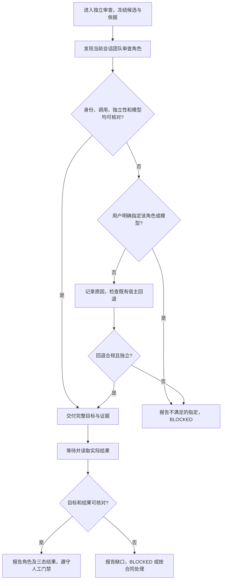

# #41 优先使用团队审查角色

状态：Draft v1；[Issue #41](https://github.com/xforce-io/keel/issues/41)；[L1 v1 与确认来源](https://github.com/xforce-io/keel/issues/41#issuecomment-6541116320)。本文件是本票唯一详细契约。

## 1 背景

`skills/keel-review/SKILL.md` 目前按当前宿主固定选择审查方式，未先发现会话已有角色；现有模型解析与结果字段分别来自 #10，人工门禁来自 #7。本会话 #40 曾明确指定 Herdr Core 角色并实际收到其审查结果。`keel check` 只校验审查来源字段与证据摘要，不解析或证明角色选择。

## 2 名词解释

[团队审查角色](../glossary.md)为本票新增名词；其身份、调用渠道和运行状态由会话或宿主提供，名称本身不证明独立性或能力。已有 reviewer 名词沿用名词表。

## 3 目标与非目标

满足 L1 v1 的 S1.A1、S2.A1、S3.A1–A2：优先可用的团队审查角色，清晰回退或阻断，保留用户指定及现有门禁。不新增审查环节、平台、模型绑定格式或 `keel check` 字段；不认证声明之外的事实、不改外部 `code-review` 合同。

## 4 能力

调用方在独立审查前基于当前会话/宿主提供的发现与操作能力，识别专职角色、核对可执行条件并交接；收到完整实际结果后核对身份与目标。用户可看到选择来源、拒绝/回退原因和审查结论。

### 4.1 UI/UX

无图形页面。会话主路径及 S1–S3 均可在下图观察：

同一轮提交失败或等待超时先核对交付、状态和输出；无法确认任务未送达时不能盲目重发，也不能把完成条件推断为已满足。被阻断的授权/提问不得代替用户回答。

## 5 思路与折衷

优先复用用户明确指定或会话已暴露的现有团队审查角色，避免将宿主原生子代理当成唯一机制。只有可查的专职身份、可调用通道、独立上下文、只读约束及实际模型与现有来源规则一致时可交接；无法观察时不猜。用户指定优先；没有指定且多个角色合格时按当前团队关系及可验证性择一并说明，不以名称推断。放弃写死 Herdr 命令、凭名字/自报断言独立、按超时盲目重试、替换用户明确指定及更改外部合同。

## 6 架构

`keel-review` 调用方负责从宿主读取团队关系和状态 → 判断合格与解析角色宿主的模型 → 用宿主提供的通道提交只读审查 → 等待、读取实际结果并核对冻结目标/来源 → 交给既有 review/release 门禁。无发现能力或无合格角色走原宿主适配；显式指定无法满足则停止。失败和不确定交付路径不得当作成功；不引入后台服务、通用跨宿主发现 API 或持久状态。

## 7 模块

`skills/keel-review/SKILL.md` 是唯一角色选择及交接行为事实源；`.agents/skills/verify-keel/features/review.md` 映射 S1–S3 用户路径；现有 `keel-release`、`agents/reviewer.md` 和模型绑定格式保持合同。术语同步 `docs/glossary.md`。

## 8 API/CLI

不新增对外 CLI、参数或持久字段。调用方按当前宿主或已启用团队能力的文档发现和委派，不探测或操作不属于本会话的角色。实际结果保留现有 `reviewer_host`、`reviewer_model`、`source` 与 `human`；审查角色身份和选择/回退依据在交接记录注明，不改变 `keel check` schema。显式模型或绑定不可运行时继续 BLOCKED，不把另一模型改写成指定 slug。

## 9 边界

用户明确要求的团队角色不可用、身份/独立性或实际模型无法核实，报告缺口，不静默回退。一般发现失败与无角色不同，须如实报告；只有能独立证明回退满足现有合同才执行。只读是受控工作方式，不能因为有角色名称就假定权限；审查者不得实施修复。现有目标完整性、preflight、三轮及真实授权、人审和发布门禁不变。

## 10 迁移/兼容/回滚

已有无团队能力的宿主沿用原适配；已有模型绑定无需迁移。安装沿用现有 skill 挂载。回滚为恢复旧 `keel-review` 合同和对应地图；无持久数据迁移。

## 11 测试计划

E2E：S1.A1 用本会话可用角色对冻结目标实际审查，记录角色、模型和实际输出；不得用测试字符串替代。S2.A1 的三类不可用情形及 S3.A1–A2 用隔离情境实际执行规则并记录观察，模拟结果与真实团队审查区分。Integration：scratch 安装与查找当前 `keel-review`，核对已有宿主/模型及发布合同，地图 `.agents/skills/verify-keel/features/review.md` 覆盖全部 S。Unit：围绕冲突/缺失场景的可执行规则测试，禁止把简单字符串出现当成实际团队协作证明。

## 12 开放问题

无未决产品问题；各宿主的发现和权限能力由实际环境决定，不能证明独立时不放行。团队工具能力有限不代表可以跳过完整差异或既有验证。

## 13 关联

[#41](https://github.com/xforce-io/keel/issues/41)、[L1 v1](https://github.com/xforce-io/keel/issues/41#issuecomment-6541116320)、#7、#10；PR 创建后通过 Issue 关联。
