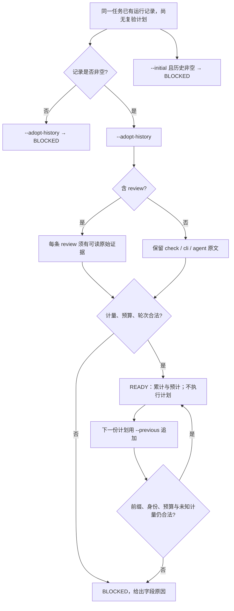

# #44 审查前运行记录的首次接入

状态：Draft v1。[Issue #44](https://github.com/xforce-io/keel/issues/44)。产品基线即该 Issue 正文（2026-11-09）的 Stories S1–S3 与验收标准；本文件整理该决定，不另作自批。

## 1. 背景与目标

`keel reverify` 已能从空历史起步，或首次接入「至少一条 review」的历史。审查前只有 check / cli / agent、且没有上一份复验计划时，两个入口都拒绝。目标是让这条记录能首次接入，并算出与现在相同的累计和预计，且检查本身不执行命令或模型。

## 2. 范围与非目标

交付 `keel reverify` 的首次接入条件、帮助文案、复验合同和回归。不做 TaskLoop 业务、不启动真实模型、不自动提高预算、不减少 review 要求、不把 READY 当成产品验收、审查或发布通过。不放宽 `--initial` 的空历史要求，不新增第四个历史入口。

## 3. 用户与产品概念

角色是 coding-agent。对象沿用[名词表](../../glossary.md)的复验计划、运行记录。无新增领域词。

## 4. 产品交互总览

S1、S2、S3 的分支都在这张图里。

## 5. 信息架构与入口

入口仍是 `keel reverify RECORD` 上互斥的 `--initial`、`--adopt-history`、`--previous`。审查前的记录走已有的 `--adopt-history`。帮助改为：首次接入已有运行记录且无先前复验计划；其中的审查须引用原始证据。成功看到 READY、累计和预计；失败看到 BLOCKED 和字段原因。没有图形页面。

## 6. Stories 与完整交互

### S1. 首次接入审查前的既有运行记录

角色 coding-agent。前置：历史非空，只有 check / cli / agent，review 数为 0，无上一份计划，其余声明合法。操作：用 `--adopt-history` 提交该计划并阅读 JSON。成功：READY，原记录与消耗保留，不要求删历史、伪造 review 或伪造 previous；`executed` 全为 false。失败：空历史仍 BLOCKED；同一份非空历史用 `--initial` 仍 BLOCKED。路径见 §4 的首次接入分支。定量：仅 check、仅 cli、仅 agent、三者混合，共 4 种。

### S2. 接入后继续保留历史与未知计量

角色 coding-agent。前置：S1 已接入的计划里有 1 次 Agent，耗时 10 秒、`model_calls=1`，不可得细项为 null，且未对这些项设限额。操作：把下一次 20 秒的 Agent 结果追加到历史，用上一份原始计划作为 `--previous` 再提交。成功：READY，累计 30 秒、`model_calls=2`，原历史前缀和候选身份逐值不变，未受限未知项的累计仍为 null。路径见 §4 从 READY 到 `--previous` 的一段。

### S3. 首次接入不削弱既有阻断规则

角色 coding-agent。前置：合法的首次接入材料，或已保存的上一份计划。操作：分别提交非法身份或计量、删改历史前缀、预算超限、对未知项设限额；并核对已有 review 的轮次与提高预算的授权。成功：反例 BLOCKED 且原因落在对应字段；改回合法材料后可继续。不能借新能力把消耗清零、跳过授权，或把 READY 当成审查通过。路径见 §4 的 BLOCKED 分支。

## 7. 产品规则与边界

- R1：`--adopt-history` 要求历史非空，不要求其中已有 review。
- R2：`--initial` 仍只接受空历史。
- R3：历史里的 review 仍须按既有规则提供可读证据；没有 review 时不编造证据。
- R4：接入之后只能用 `--previous` 接续。历史前缀、候选身份和已有扩展不能改。未设限的未知计量保持 null，累计不因当时没有 review 而重置。
- R5：非法身份或计量、前缀被删改、预计超过限额、受限指标未知，仍然 BLOCKED。三轮审查和预算追加授权的边界不变。
- R6：READY 只表示只读核对完成。

工具仍然不能发现调用方故意少报历史。这不是本票新能力。

## 8. 验收与效果验证

| ID / 关联 | 前置 | 路径 | 结果与禁止行为 | 证据 / 执行 / 属性 |
|---|---|---|---|---|
| S1.A1 / S1 / R1 R6 | 4 种非空历史，0 条 review，无 previous，其余合法 | `keel reverify --adopt-history --json` | 四种都 READY；累计等于这些记录之和；不执行计划 | 四种 JSON 的 status、cumulative、actions.executed；agent 可执行；必需 |
| S1.A2 / S1 / R2 | 同一份仅 agent 历史；另取空历史 | `--initial`；空历史 `--adopt-history` | 都 BLOCKED。前者说明须用 `--adopt-history` 或 `--previous`；后者说明 adopt 需要非空历史 | 两条 checks.field；必需 |
| S2.A1 / S2 / R4 | S1 的 10 秒 Agent 计划已保存；追加 20 秒 Agent；细项 null 且未设限 | `--previous --json` | READY；累计 30 秒、model_calls=2；前缀逐值不变；未知累计为 null | JSON cumulative 与上一份 history 对照；必需 |
| S3.A1 / S3 / R5 | 合法接入材料 | 非法候选或 model_calls，修正后再提交 | 先 BLOCKED 于身份或计量字段，修正后 READY | 两次 JSON；必需 |
| S3.A2 / S3 / R4 R5 | 已有上一份计划 | 删或改历史前缀后 `--previous` | BLOCKED，字段为 history.append-only | JSON checks；必需 |
| S3.A3 / S3 / R5 | 累计加预计超过 elapsed 或 model_calls 限额 | `--adopt-history` 或 `--previous` | BLOCKED，字段为 budget.exceeded | JSON checks；必需 |
| S3.A4 / S3 / R5 | 历史细项为 null，并对该指标设限额 | `--adopt-history` | BLOCKED，字段为 budget.unknown；不把 null 写成 0 | JSON cumulative 与 checks；必需 |
| S3.A5 / S3 / R5 | 三轮 review 无扩额；或提高 limits 但无授权 | 原有 `--adopt-history` / `--previous` | 仍分别 BLOCKED 于 review.round_limit、budget_authorization。发布门禁文件不改 | JSON checks；发布相关路径与本票 diff 为空；必需 |

## 9. 折衷与开放问题

沿用 #40 已放弃的「放宽 `--initial`」。也不新增入口：审查前记录和已有审查都是「无 previous 的首次接入」，差别只在有 review 时才核对证据。开放问题无。调用方隐瞒更早记录仍不能由工具发现。
