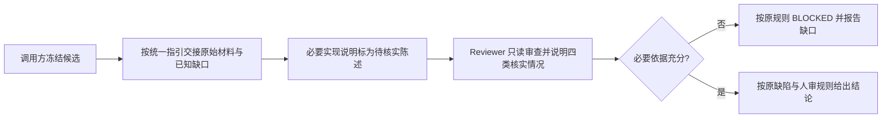

# L1：审查交接依据与实际核实边界

版本：v1；状态：Draft，采用本会话已明确范围。[Issue #48](https://github.com/xforce-io/keel/issues/48)。

L1：write，明确 agent 的交接与结果说明行为。L2：skip，沿用 Markdown skill、既有审查角色及证据机制，无新增接口或存储契约。基线已包含 #49 的自足审查准则和可选外部规则，本票不恢复旧硬依赖。确认来源：用户讨论优化点后要求“建立issue做改进，不要过度工程”，并继续要求“端到端完成修改测试和review”；仅落实已讨论的前三项，不引入工具化。

## 1. 背景与目标

当前机制见 [keel-review](../../../skills/keel-review/SKILL.md)：送审材料分散在开头及角色交接段，结果要求三态、human 与来源字段；缺少明确的自我评价隔离和核实方式说明。本票让材料完整且事实与评价可区分，让读者知道 Reviewer 实际核实了什么。

## 2. 范围与非目标

仅整理 keel-review 的交接指引，隔离实现者自我评价，补充四类核实说明。不新增 CLI、schema、校验器、Action 或门禁，不复制外部 code-review checklist，不改模型选择、人审条件、三态、缺陷阻塞规则或三轮上限。

## 3. 用户与产品概念

调用方提交原始需求、冻结目标与证据；Reviewer 独立判断并说明依据。沿用 [名词表](../../glossary.md)，无新术语。

## 4. 产品交互总览

S1、S2 均沿用以下完整路径：

## 5. 信息架构与入口

入口仍为 keel-review。送审材料集中在该 skill 的交接表中，结论沿用既有输出并补简短说明；无新命令或独立表单。

## 6. Stories 与完整交互

- **S1**：调用方已有冻结候选及相关材料，从交接指引整理任务、差异、设计验收、原始结果、审查合同和未解决项。必要解释标为待核实陈述，自我评价不能作为通过依据。缺材料按原规则 BLOCKED，不删风险或失败记录来获得通过。路径见 §4 A→B→C→D→E。
- **S2**：Reviewer 读取交接后说明直接审阅、亲自执行、依赖已有证据及无法核实四类情况；未执行写明未执行，运行证据注明来源。调用方能区分静态审阅与实际执行，缺必要依据仍阻断。路径见 §4 D→E→F/G。无需重复运行全部测试。

## 7. 产品规则与边界

事实与待核实说明分开，不隐去负面证据。说明方式是现有审查输出的简短补充，不增加机器字段或新审批步骤。保持当前模型、只读、三态、人审及来源合同；本次产品范围确认不充当候选生成后的人工批准。

## 8. 验收与效果验证

S1、S2 的主要功能文件均为 [review.md](../../../.agents/skills/verify-keel/features/review.md) 的 #48 条目。以下均必需、agent 可执行；从隔离安装后的 skill 入口运行合成审查交接情境，记录真实 agent 输入输出，不能用字符串检查冒充行为验证，也不将合成任务当真实交付批准。

| ID / Story | 前置与入口操作 | 判定及禁止结果 | 证据 |
|---|---|---|---|
| S1.A1 / S1 | 提供冻结目标、设计映射、原始结果、失败记录及“已完整覆盖”的实现者评价；调用方读取已安装 skill 后准备交接 | 现有必需材料完整，自我评价不作通过依据；必要解释单列为待核实；失败和缺口保留 | 输入、交接原文、安装目标与候选关系 |
| S1.A2 / S1 | 缺完整 diff 或当前预检等必要材料，从同一入口处理 | 按原规则报告 BLOCKED 及缺口，不根据实现者评价补造通过 | 缺材料情境与实际输出 |
| S2.A1 / S2 | 提供原始测试输出，Reviewer 仅静态审阅且不执行测试 | 四类核实情况明确；亲自执行为未执行；采用原始结果注明来源，不冒称重新运行；保留既有结论字段 | Reviewer 输入输出、工具执行记录 |
| S2.A2 / S2 | 对照当前基线规则和本次完整差异 | 既有审查准则、三态、模型、人审、来源和三轮规则保持，无新增 CLI/schema/校验器/门禁 | 完整 diff、现有回归输出及独立审查 |

隔离安装、读取 skill 和清理按现有 verify-keel 手册；Doctor 或查找条件缺失记 blocked，合成情境和测试不能消除该缺口。现有回归用于兼容验证；长期偏见减少或审查效率不作为本票已证明收益。

## 9. 折衷与开放问题

选择一张交接表和一段核实说明，不做自动化。没有未决产品取舍；实际宿主和外部审查合同的可用性在执行时如实记录。
