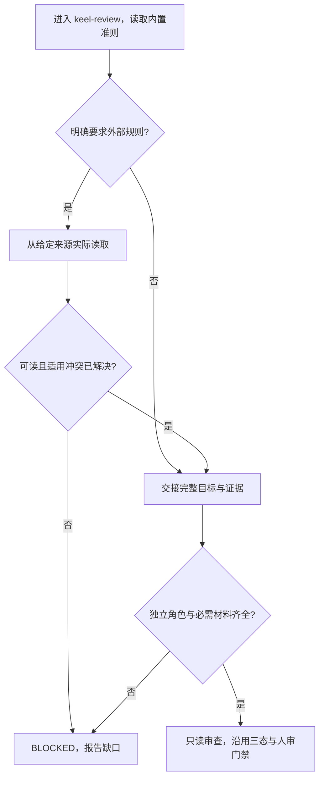

# L1：独立审查不依赖外部定位工具

版本：v1；状态：Draft，采用本会话已确认范围。[Issue #49](https://github.com/xforce-io/keel/issues/49)。确认来源：用户接受“先独立改造依赖，再恢复 #48”的具体建议，并要求“端到端按你建议的顺序完成”；保留候选生成后的真实人审要求。

## 1. 背景与目标

当前 keel-review 强制 local-skill 查找 code-review，Doctor 将该命令缺失当安装失败。当前环境已复现；bundled 同名 skill 不含 keel 假定的分级。让审查准则自足、定位方式可替换、安装诊断只判断 keel 挂载。

## 2. 范围与非目标

覆盖最小审查准则、明确要求的外部合同、Doctor、角色及引用和验证。无新 CLI/flag/schema、搜索器或配置系统；不复制其他项目 skill，不改模型、独立性、三态、人审、三轮或发布要求，不包含 #48 的交接优化。

## 3. 用户与产品概念

调用方准备冻结目标和证据，Reviewer 独立只读审查，用户或项目可要求额外规则。沿用 docs/glossary.md，无新领域对象。

## 4. 产品交互总览

S1、S2 的完整路径如下；S3 沿用 install → doctor → uninstall，无新交互分支。

## 5. 信息架构与入口

keel-review 仍为唯一审查环节，其正文包含最低要求。用户或项目给出的外部来源是补充，无需安装同名 skill。宿主提供的列表、明确路径和可用的 local-skill 均可帮助定位，须实际读取。Doctor 不执行外部合同发现；无新命令。

## 6. Stories 与完整交互

- S1：从 §4 A→B→D→G→H 读取内置准则并审查完整候选；缺工具不阻断，缺必要材料或独立角色仍按 G→F 阻断。
- S2：从 B→C→E 实际读取明确要求的规则，交接来源、版本和范围；不可读或未解决冲突走 F，不能以默认准则掩盖缺口。项目更严规则仍有效。
- S3：在隔离 home 安装后 Doctor 成功、卸载完成；缺挂载和外来占用时 Doctor 失败并给出原有修复提示，文件不变。本 Story 单步诊断及现有安装链无新增交互，图省略。

## 7. 产品规则与边界

默认准则覆盖正确性、边界/回归、安全、接口/数据/权限契约、可维护性及证据；给出 P0–P3 含义，保持现有阻塞判定。不能用测试通过推断未运行行为，缺陷须有具体依据。外部规则不能放松原门禁，冲突须解决。Doctor 成功只代表挂载正常，不证明角色独立、模型可用、材料完整或已批准发布。

## 8. 验收与效果验证

S1、S2 主要映射 .agents/skills/verify-keel/features/review.md 的 #49；S3 映射 doctor.md。以下均必需、agent 可执行，标准与执行结果分开保存。

| ID / Story | 前置、入口与操作 | 可判定结果及禁止结果 | 证据 |
|---|---|---|---|
| S1.A1 / S1 | 隔离安装，真实独立 agent 读取已安装准则，给完整合成代码差异及证据，无外部工具/skill | 能审查并引用缺陷依据，保留现有三态/human/来源；不因缺工具阻断，不声称合成审查批准真实候选 | 安装路径、SHA、输入及 agent 输出 |
| S1.A2 / S1 | 同一入口但缺完整差异或必要证据 | 明确 BLOCKED，缺口不被默认准则掩盖 | 原始情境与实际输出 |
| S2.A1 / S2 | 用户给定可读附加规则文件，从给定路径读取并审查违反它的合成变更 | 规则实际参与判断，记录来源/版本/范围，不以名字假定适用 | 文件、读取记录、交接与输出 |
| S2.A2 / S2 | 明确要求的规则路径不可读，或规则冲突未解决 | BLOCKED 并说明原因，不静默回退成通过 | 两种情境的实际输出 |
| S3.A1 / S3 | 无 locator/外部 skill 的 scratch install → doctor → uninstall；另有会失败的可选 locator | 正常链退出 0，Doctor 不调用 locator；卸载只清理本次安装，state 与外来文件不被 Doctor 改动 | 命令、退出码、状态前后摘要、清理记录 |
| S3.A2 / S3 | 空 scratch home 执行 Doctor | 退出 1，报告缺挂载和修复提示，未创建状态 | 原始输出及文件核对 |
| S3.A3 / S3 | scratch 预放外来 skill，执行 Doctor | 退出 1，报告占用，外来文件不变 | 原始输出及摘要 |

真实 agent 情境不能用硬编码输出替代；可用合成业务隔离失败注入，不冒充真实服务或本票正式审查。兼容回归跑项目规定五个 unittest 模块；正式审查核对原模型、人审、三态和发布边界。长期收益不在本票宣称。

## 9. 折衷与开放问题

选择少量内置准则，避免固定依赖单一宿主中的同名 skill。外部规则只按明确来源加载，不实现自动搜索。没有待定产品取舍。首次改造的正式审查同时参考改动前的门禁原文和已发现的 Grok code-review；这是本会话已授权解除定位硬依赖的范围，不把候选新规则作为自己的合入批准。
