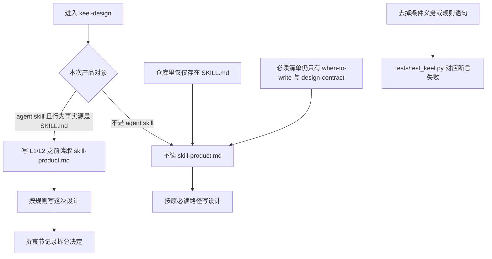

# L1 产品设计：设计 agent skill 时才应用技能产品拆分规则

版本：v3。状态：Draft。Issue：[54](https://github.com/xforce-io/keel/issues/54)。

L1：write。L2：skip。沿用现有的按需读取参考文件机制，没有新的命令、schema、存储或检查器。

确认来源：本会话。用户要求把技能产品拆分规则放进 keel，以免开发 skill 时随身带 PDF。随后确认这套规则不得影响多数非 skill 工作区，且不要过度设计。触发认「本次产品对象是 agent skill，行为事实源是 `SKILL.md`」，不认仓库里存在 `SKILL.md`。规则列表即下文 R1。该确认覆盖本票范围。v2 修订依据：本次 PR #55 复审指出原 PDF 的拆分建议被误改为三个条件同时满足的硬门槛；用户随后要求“modify，and pr again”，授权恢复原文的判断性质并更新 PR。v3 修订依据：用户进一步要求不引用文章名称，并指出缺少何时使用 Playbook、Subskill 等规则；本版补齐抽象选择、组合与职责边界，新增术语定义。此确认不代表对新候选的人工审查批准。

## 1. 背景与目标

设计阶段每次先完整读取两份合同，见 `skills/keel-design/SKILL.md` 的「先完整读取」：`../keel/references/when-to-write.md` 与 `references/design-contract.md`。另一份参考 `references/clarification.md` 只在草稿有未决产品取舍时读取。共享大纲在 `references/design-contract.md`。路由器 `skills/keel/SKILL.md` 不抄环节规则。

目标是：本次产品对象是 agent skill、且行为事实源是 `SKILL.md` 时，写 L1/L2 之前应用同一套拆分规则；其它产品对象不读、也不满足这套规则。

## 2. 范围与非目标

In：`skills/keel-design/SKILL.md` 一条按需读取，`skills/keel-design/references/skill-product.md` 一份可独立使用的规则（含抽象选择表、拆分判据、组合边界及验证要求），`docs/glossary.md` 的相关术语定义，以及 `tests/test_keel.py` 对条件义务和规则语句的断言。

Out：交付状态机、新环节、新 skill、`when-to-write.md`、`keel-dev`、共享 L1/L2 大纲的始终义务、动态改道、Playbook 注册表、运行时平台、`commands/` / `playbooks/` / `evals/` 目录、因仓库含 `SKILL.md` 而触发、修改 energy-cli 或其它产品仓库。

## 3. 用户与产品概念

coding-agent 在设计阶段写 L1/L2。开发者用仓库测试锁住条件义务和规则文本。已有术语见 [名词表](../../glossary.md)。本票补充 Command、Playbook、Skill、Subskill、Subagent、Orchestrator、Runtime、Eval 的定义；规则仅在本票原有狭触发下适用，名词表不增加行为义务。

## 4. 产品交互总览

## 5. 信息架构与入口

入口仍是 keel-design。必读清单保持两份。条件句指向 `references/skill-product.md`，该文件是规则事实源。没有新页面、命令或初始化。

## 6. Stories 与完整交互

- **S1**：产品对象是 agent skill 且行为事实源是 `SKILL.md` 时，写 L1/L2 之前读取规则并遵守。路径为 §4 的 A→B→C→D→E。对应 S1.A1–A4。
- **S2**：产品对象不是 agent skill 时不读、不满足该规则集。必读清单不增加。路由器、名词表、when-to-write、keel-dev 与共享 L1/L2 大纲没有新增始终义务。仅因仓库含 `SKILL.md` 不触发。路径为 §4 的 B→F、G→F、H→F→I。对应 S2.A1–A2。
- **S3**：去掉条件义务或规则集可识别语句时，对应仓库测试失败；原文在场时 `python3 -m unittest tests.test_keel tests.test_keel_reflect_inspect` 退出码为 0。路径为 §4 的 J→K。这是仓库测试，不是一条新的用户界面。对应 S3.A1–A2。

三条都指向 §4，不另画重复图。

## 7. 产品规则与边界

R1. 条件成立时，Skill 定义专业方法、适用场景、输入输出、工具依赖、合格标准与验证方式，不掌管整次任务生命周期或宿主路由。另立 Skill 参考独立稳定的方法、明确的输入输出、独立评测需要等维度；不要求同时满足，也不因命中一项就必须拆分。简单、只用于单一流程且无明显复用价值的动作留在内部参考。Subskill 是范围更窄的 Skill，沿用相同判断与契约，不引入嵌套层级。换执行者复用同一 Skill，不复制方法。

R2. 触发只认本次产品对象。仓库里仅仅存在一份 `SKILL.md` 不构成触发。不读的设计不必满足 R1。

R3. 必读清单、路由器、名词表、when-to-write、keel-dev、共享 L1/L2 大纲不新增这套始终义务。

R4. 应用本规则的设计在 L1 折衷节记录主要职责的抽象选择、拆分判据、内部参考、独立能力、执行主体、运行保障和放弃项。

R5. Command 用于入口；Playbook 用于可复用的完整任务流程，定义阶段、依赖、分支、检查点、完成标准和失败回退，引用 Skill 而不复制方法。Orchestrator 根据结果调整路径；Subagent 解决上下文、模型、权限或并行隔离；Runtime 承担持久状态、审批、审计和可靠重试。规则说明何时选择这些职责，不要求本仓新增对应系统、目录或注册表。

R6. 小流程变体留在 Playbook 参数、可选步骤或分支中，方法差异留在 Skill 内；不为每种组合新增 Playbook，不把所有变体塞进入口路由表。按实际涉及的层次验证 Skill / Subskill 的方法和结果、Playbook 的流程完整性、最终任务的交付目标；不以调用成功代替质量判定。参考文件直接写全这些规则，不依赖外部文章名称或章节号。

## 8. 验收与效果验证

本票没有 install、doctor、uninstall 或其它 CLI 用户路径。功能地图没有对上的入口，不新增 Drive 场景。下列必需项由直接读取仓库文件的单元测试判定。S1.A3 由本文件 §9 判定。

| ID / 关联 | 前置、入口与操作 | 可判定结果与禁止结果 | 证据要求 |
|---|---|---|---|
| S1.A1 / S1 / R1 / R4 | 读 `skills/keel-design/SKILL.md`。产品对象是 agent skill，行为事实源是 `SKILL.md` | 写 L1/L2 之前指向 `references/skill-product.md`。该句不在「先完整读取」清单内 | 原文与单元测试 |
| S1.A2 / S1 / R1 | 读 `references/skill-product.md` | R1 的规则语句都在；拆分判断保留建议性质，不是三个条件同时满足的硬门槛；有判断表及正反例 | 原文与单元测试 |
| S1.A4 / S1 / R5 / R6 | 读取规则中的抽象选择表、流程边界和验证要求 | 明确八种抽象的适用条件及组合；区分 Subskill 与内部步骤、Subagent；流程引用能力不复制；规则独立可读，不引用外部文章名称或章节号 | 原文与单元测试 |
| S1.A3 / S1 / R4 | 读本文件 §9 | 记录本票的拆分决定，并引用本会话对狭触发和规则列表的确认 | 本文件 §9 |
| S2.A1 / S2 / R2 / R3 | 产品对象不是 agent skill；读必读清单 | 不必读 `skill-product.md`。必读清单仍只有 when-to-write 与 design-contract | 原文与单元测试 |
| S2.A2 / S2 / R3 | 读路由器、`docs/glossary.md`、`when-to-write.md`、`keel-dev/SKILL.md`、`design-contract.md` | 这些文件不引用 `skill-product.md`，也不写入 R1 的规则语句 | 原文与单元测试 |
| S3.A1 / S3 | 读 `tests/test_keel.py` 中本票测试 | 断言条件义务、R1 的可识别语句，以及必读路径和 S2.A2 的文件不含该规则集 | 测试源码 |
| S3.A2 / S3 | 原文在场时运行 `python3 -m unittest tests.test_keel tests.test_keel_reflect_inspect` | 退出码为 0。去掉条件义务或规则语句时对应断言失败 | 命令输出 |

E2E：无用户路径，不 Drive。Integration：N/A，没有新的安装面或进程边界。Unit：`tests/test_keel.py` 直接读取设计阶段正文和规则文本。

## 9. 折衷与开放问题

拆分决定：

- 规则留在一份按需参考。设计阶段只在本次产品对象是 agent skill、且行为事实源是 `SKILL.md` 时读取。
- 不另立 skill，不把规则放进必读清单，不抄进路由器、名词表、when-to-write、keel-dev 或共享 L1/L2 大纲。
- 内部步骤不拆成新 skill。本票没有换执行者，也没有第二份入口。
- v2 撤回“三项同时满足”的收紧，保留多个判断维度及建议性质；不用建设新的运行时或评测目录来落实这项修正。S1.A2 编号不变，增加对该语义的核对。
- v3 补齐概念选择，不将它们实现为新系统。新增 S1.A4 覆盖选择表、组合边界与独立可读性，保留其他验收编号；更改名词表仅补定义，不传播始终义务。
- 放弃：每次设计都读、看见仓库里有 `SKILL.md` 就触发、动态改道、Playbook 注册表、运行时平台，以及 `commands/` / `playbooks/` / `evals/` 目录。

确认来源即文首所引的本会话。无未决产品问题。
