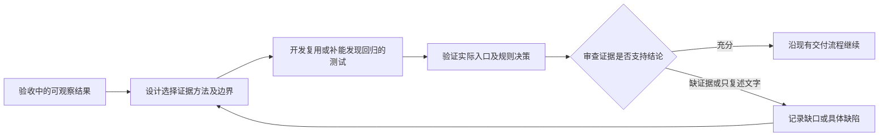

# L1 产品设计：按证据目标选择测试

版本：v1。状态：Draft。关联 [Issue #56](https://github.com/xforce-io/keel/issues/56) 的追加 S5；S1–S4 已由 [PR #57](https://github.com/xforce-io/keel/pull/57) 交付，本稿不重写其历史标准或证据。

L1：write，改变 agent 选择与审查测试的规则。L2：skip，沿用跨 skill 参考文件读取，无新命令、schema、运行时或依赖。沿用仓库已采用的 L1 产品 / L2 技术设计定义；AGENTS 的旧概要 / 详细命名与此不同，本稿不将它们假称同义。

确认来源：本会话已明确指出需要在设计、开发、审查中区分结构、运行行为与规则决策证据；用户要求“can you enhance this in #56”，授权在原 Issue 追加此范围。不是对未来候选的人工审查批准。

## 1. 背景与目标

仅在本仓测试说明中禁止逐句锁定，不能指导其他项目的 agent。目标是在设计证据、编写测试和验收审查时，按产品契约选择有观察力的验证，避免把文字在场当成规则有效。

## 2. 范围与非目标

In：共享准则、设计/开发/验证/审查四个消费者、可安装引用、普通应用与规则决策的实际样例。Out：新 skill、路由或交付门禁、模型平台、自动语义评分器、禁止一切字符串断言、强制每票新增测试、批量重排历史设计。

## 3. 用户与产品概念

开发者和 coding-agent 使用既有环节；既有术语见 [名词表](../../glossary.md)，无新增规范术语。共享准则是内部参考，不另立 Skill，不增加执行主体。

## 4. 产品交互总览

## 5. 信息架构与入口

准则仅在 `skills/keel-dev/references/test-strategy.md` 维护。设计合同、keel-dev、keel-verify、keel-review 分别在选择或核对证据时引用；普通应用同样适用，不以产品对象是 Skill 为前提。无新 UI/CLI。

## 6. Stories 与完整交互

S5 沿 §4 路径：验收先定义结果；设计说明验证对象和证明边界；开发避免无价值措辞锁定并复用现有检查；验证区分结构、运行结果与决策；Reviewer 对证据观察力不足给出现有三态中的正确结论。无可验证行为变化的等义整理不机械新增单测。缺执行条件如实 blocked/not_run，不用文本命中顶替。所有调用、批准、合入仍按原流程，无额外界面或批准入口。

## 7. 产品规则与边界

R1：按需求中的可观察结果选择验证；文件/链接/机器字段用结构检查，执行行为从合适的真实边界验证，规则决策用输入、预期结果和独立判断。某一类证据不扩大为另一类通过。

R2：自然语言不默认逐句匹配；稳定状态码、命令、协议字段、机器元数据及明确固定措辞契约仍可断言。纯等义整理可复用现有检查，不因流程有测试阶段就新增测试。

R3：新增测试须能说明观察哪项回归，并考虑等价实现是否误报、违反需求是否能被发现；这是选择与审查依据，不要求每票建设变异框架或跑满所有测试层。

R4：Reviewer 不用测试数量或绿色结果代替证据充分性。只复述规则的测试不能证明规则生效；缺必要证据按现有合同 BLOCKED，已确认违约按缺陷分级，不增加第四种结论或新门禁。

## 8. 验收与效果验证

| ID | 前置与入口 | 可判定结果与禁止结果 | 证据 / 执行 / 属性 |
|---|---|---|---|
| S5.A1 | 安装当前候选，读取四个消费者和准则 | 四处可到达同一准则；准则适用于普通项目，不依赖本仓 tests/README，也不逐处复制整套规则 | scratch 读取路径及摘要；结构测试；agent可执行；必需 |
| S5.A2 | 合成普通应用输入，规划文案、CLI及规则测试 | 等义说明不强制新测试，CLI错误码允许字符串断言，运行回归观察实际结果，规则效果不用全文/关键词命中替代 | 新增固定样例06、实际回答与独立评估；agent可执行；必需 |
| S5.A3 | 同一输入只有文案匹配通过，缺行为证据 | 指出不足及应补的证据，不以原文在场/测试数量放行；不虚构已执行或额外批准门 | 样例06、实际回答与独立评估；agent可执行；必需 |
| S5.A4 | 当前候选运行既有回归及受影响决策样例 | 结构/CLI回归通过；原五组及新增06有当前实际输出与独立结论，不把旧结果改SHA | 完整unittest、六组重放及04后续；agent可执行；必需 |

主要功能文件：`.agents/skills/verify-keel/features/verify-gates.md` 的 #56 追加 S5。E2E：scratch 安装后的入口与决策重放；Integration：本地引用及安装回归；Unit：既有结构与可执行测试。未做跨模型长期效果承诺。

## 9. 折衷与开放问题

规则集中为内部参考，四个环节只写对应消费职责；不另立测试 Skill，不把方法抄回路由器。保留有价值机器接口断言，不以删除字符串断言数量为目标。放弃强制新测试、自动语义解析、每票新增文档或变异平台。没有影响本范围的未决产品问题；后续候选的人审独立处理。
