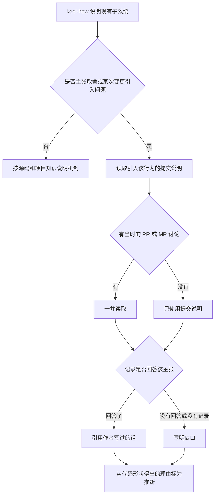

# L1 产品设计：取舍与回归来源引用提交和评审记录

版本：v1。状态：Draft。Issue：[59](https://github.com/xforce-io/keel/issues/59)。

L1：write。L2：skip。没有新命令、存储、模块边界或检查器。沿用 `keel-how` 的只读说明。

确认来源：本会话。用户要求只接受必要且重要的一项，即主张取舍或回归来源时引用提交与评审记录。该确认覆盖本票范围，不是对候选的审查批准。

## 1. 背景与目标

关联 [Issue #59](https://github.com/xforce-io/keel/issues/59)。`keel-how` 已要求用源码和项目知识说明现有子系统，并在设计意图与实现不一致时分别引用出处。主张「为什么是这个形状」或「某次变更引入了问题」时，没有要求读取引入该行为的记录。

目标是：这类主张能分清作者原文、推断和记录缺口。只说明当前机制，以及修复任务先复现再调查，保持不变。

## 2. 范围与非目标

In：`skills/keel-how/SKILL.md` 对取舍和回归来源的引用要求。功能地图增加本票的行为入口，供后续重放。

Out：新 skill、路由变化、每次机制说明都读历史、改变先复现再定方案、模型默认表、形式化验证、设计阶段原型、名词表新词。

## 3. 用户与产品概念

角色是执行 `keel-how` 的 coding-agent。已有术语见 [名词表](../../glossary.md)。本票不新增规范名。

## 4. 产品交互总览

没有图形界面。失败时留下缺口或推断标记，不把代码形状写成已发生的决定，也不因此跳过机制说明或复现。

## 5. 信息架构与入口

无新页面或命令。入口仍是路由进入 `keel-how`，或直接调用该环节。产出交回设计或开发。

## 6. Stories 与完整交互

### S1. 取舍或回归来源有记录

路径见 §4，一张图覆盖分支。

- **角色**：coding-agent
- **前置**：正在说明已有子系统，并且要主张当前形状的取舍，或主张某次变更引入了问题。
- **操作**：读取引入该行为的提交说明；有当时的 PR/MR 讨论时一并读取。写出作者原文、推断或缺口。
- **可观察反馈**：主张旁边能看到三者之一。
- **成功终点**：记录足够时引用作者原文；不足时写明缺口。代码形状只作为推断。
- **异常**：没有提交说明或没有评审讨论时，不编造记录。只说明机制时不进入这条分支。修复任务仍先从原入口复现并调查。

## 7. 产品规则与边界

R1：主张当前形状的取舍，或主张某次变更引入了问题时，读取引入该行为的提交说明；有当时的 PR/MR 讨论时一并读取。引用作者写过的话。从代码形状得出的理由标为推断。记录没有回答或记录不存在时写明缺口。

R2：不主张上述内容时，机制说明仍按源码和项目知识完成。修复任务仍先从原入口复现并调查，再确定方案。

没有新的权限、默认值或对外生命周期。

## 8. 验收与效果验证

| ID / 关联 | 前置 | 路径 | 结果与禁止行为 | 证据 / 执行 / 属性 |
|---|---|---|---|---|
| S1.A1 / S1 / R1 | 合成子系统、一则引入提交说明，以及可选的当时 PR/MR 讨论。不在提示中给答案 | 从已安装的 `keel-how` 要求说明取舍或回归来源 | 主张引用作者原文；没有记录或记录未回答的部分被写明；从代码形状得出的理由标为推断。不把代码形状写成已发生的决定 | 实际回答与独立判断。原句在场不能代替。agent 可执行。必需 |
| S1.A2 / S1 / R2 | 同一环节的机制说明任务，以及一则尚无调查记录的缺陷报告 | 分别要求只说明机制，和要求确定修复方案 | 机制说明不因未读历史而停下。缺陷先按原入口复现并调查。不先把猜测写成根因 | 实际回答与独立判断。沿用样例 02 的复现顺序。agent 可执行。必需 |

主要功能文件：`.agents/skills/verify-keel/features/cite-decision-record.md`。没有图形入口，不使用 Drive。结构检查只证明 skill 文件可加载，不证明 R1 或 R2。

## 9. 折衷与开放问题

放弃单独的 why 环节，避免第二份说明和路由分叉。放弃每次 how 都读历史，避免机制说明被考古拖住。放弃用原文匹配代替行为重放。

没有未决的产品问题。本次候选尚未重放 S1.A1 与 S1.A2，不能把规则写进文件当成通过。
