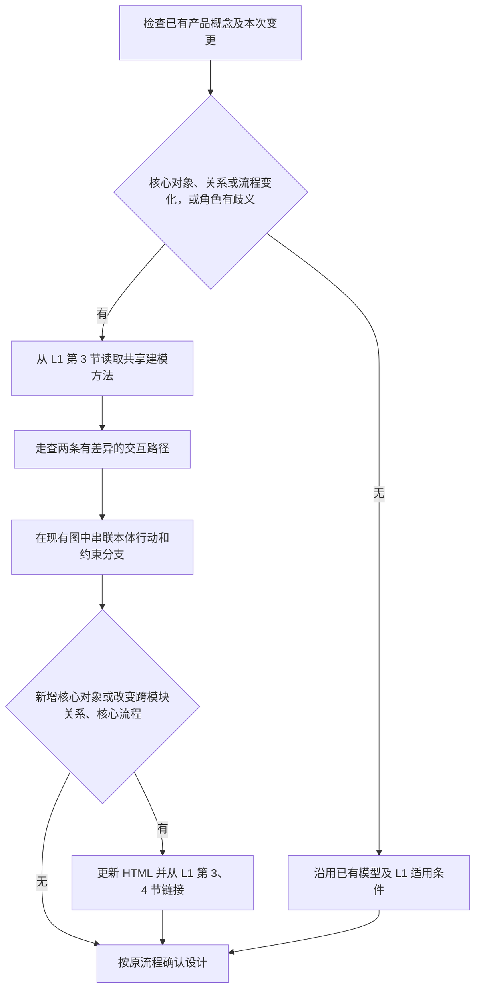

# L1 产品设计：按需用真实流程核对产品概念

版本 v3，状态 Draft，关联 [Issue #62](https://github.com/xforce-io/keel/issues/62)。对应确认来源为本次会话对共享方法、补全核心业务流程和维护 HTML 的决定。

L1 编写。现有手段可承载按需引用，L2 不适用，因为本次沿用 Markdown 参考文件和既有设计流程。

## 1. 背景与目标

L1 第 3 节已经收集产品对象和关系，第 6、7 节维护交互和约束。本次让设计者用不同的真实路径校正对象边界，再用定义的行动和风险约束表达核心业务流程。

## 2. 范围与非目标

支持新增核心产品对象、改变跨模块关系或核心业务流程，以及跨场景对象角色有歧义的产品设计。HTML 随已有设计评审维护。新阶段、检查器和运行时集成在本次范围外。

## 3. 用户与产品概念

设计者与 coding-agent 共用 L1 第 3 节的指引。产品概念模型沿用所在项目的名词表、对象关系图、产品规则及验收。参见模型评估示例的[对象关系](ontology.html#objects)。

## 4. 产品交互总览

参见模型评估示例的[核心业务流程](ontology.html#flow)。

## 5. 信息架构与入口

从 `keel-design/SKILL.md` 进入设计合同的 L1 第 3 节。共享方法位于该节的按需链接。

## 6. Stories 与完整交互

- **S1** 对应 §4 的 A→B→C→D→E→H→G，触发 HTML 更新时经过 I。走查创建和复用路径后，在一条核心业务流程中显式连接行动、对象、状态或产出，并说明阻断后的恢复路径。
- **S2** 对应 §4 的 A→B→F→G。已有产品语义且本次只改文案、布局或修复到既有契约时，沿用相应的设计路径和验收。

## 7. 产品规则与边界

R1. 按需方法采用 BKN Foundry 的对象、关系、行动和风险分类。借两条有差异路径校正对象边界，同一个实例仅改变用途时用关系记录角色。

R2. 走查结论回到现有 L1、验收及项目维护的共享模型。核心业务流程沿用总览或适用的 Story 路径，逐步引用行动、对象、关键输入关系及产出，并表达风险分支。触发由实际语义变化决定，沿用本来的 L1/L2 适用条件和确认规则。

R3. 新增核心对象、改变跨模块关系或改变核心流程的主路径或关键分支时，更新已有的模型 HTML。初次创建可放在 L1 同目录。第 3、4 节分别链接对象关系和核心流程，HTML 随同一份 L1 评审维护。

## 8. 验收与效果验证

对应应用功能地图 [product-ontology.md](../../../.agents/skills/verify-keel/features/product-ontology.md)。

| ID | 前置与真实入口 | 可判定结果 | 证据与执行 |
| --- | --- | --- | --- |
| S1.A1 | 安装候选的 `keel-design`，针对已有训练产物又可作后续运行输入的案例使用 L1 第 3 节 | 找到共享方法，先后走查两条路径，复用同一个模型版本对象并区分角色，写明权限或输入风险及可观察的阻断结果 | 必需。隔离安装及 Agent 原始输出，由独立评审员核对 |
| S1.A2 | 用同一案例完成现有 L1 总览或对应 Story 路径 | 串出从登记模型、提交评估到查看比较的核心业务流程。关键步骤可对应已定义的行动、对象及结果，权限阻断与恢复去向明确 | 必需。同一隔离验收的流程图或流程正文，由独立评审员核对 |
| S1.A3 | 走查新增评估基线关系的案例 | L1 第 3、4 节分别定位至同一 HTML 的对象关系及核心流程，离线可打开，主路径和恢复分支与正文一致。有现成模型页时沿用原页 | 必需。浏览器、链接及复用路径证据，由独立评审员核对 |
| S2.A1 | 通过同一入口处理只调整显示文案的案例 | 沿用已有对象和流程，新增建模步骤、评审阶段和 HTML 产物均为零 | 必需。同一隔离验证中的独立案例，由独立评审员核对 |

## 9. 折衷与开放问题

以一份可单独阅读的方法供两套工作流引用。keel 只在已有设计合同内提供入口，保留项目对概念模型存放位置的选择。后续实际效果以需求中是否找出可验证的概念边界问题为观察项。
