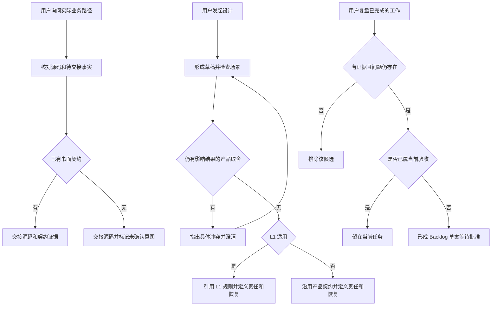

# L1 产品设计：领域事实、设计反例与代码库复盘

版本 v1，状态 Draft。关联 [Issue #66](https://github.com/xforce-io/keel/issues/66) 与[原始 PR #61](https://github.com/xforce-io/keel/pull/61)。会话中用户要求审查并合入 #61，明确指出只写 L2 的路径必须保留，随后要求按修复后的范围建立 Issue 并端到端交付。

L1 编写。L2 不适用，沿用既有 skill 入口、参考文件和安装机制，本次无需定义新的技术契约。

## 1. 背景与目标

在 [#66](https://github.com/xforce-io/keel/issues/66) 的三个入口中，用户要看到能追溯的领域事实、设计草稿中的具体反例，以及有证据的后续改进。

## 2. 范围与非目标

覆盖术语和规则的归属、反例与失败恢复、Backlog 准入。沿用原交付阶段、设计触发条件、安装 CLI 和 schema。

## 3. 用户与产品概念

用户提供任务和已有契约。coding-agent 在调查中记录可核验事实，在设计中使用已确认的产品规则，在复盘中把仍未解决的维护困难写成候选。沿用[名词表](../../glossary.md)中的 Skill 与 L1/L2 定义。

## 4. 产品交互总览

## 5. 信息架构与入口

分别从安装后的 `keel-how`、`keel-design` 和 `keel-reflect` 进入。沿用各 skill 对源码、设计合同和 Backlog 准入的现有引用入口。

## 6. Stories 与完整交互

- **S1** 对应 H→H1→H2→H3/H4。用户提供待调查的业务路径，agent 可读取项目源码，沿实际路径定位术语、规则、责任和状态交接。书面契约缺失时仍交接已核实事实，并指出哪些产品意图有待确认。
- **S2** 对应 D→D1→D2→D3/D4→D5/D6。用户给出草稿范围和适用依据，agent 先检查真正影响结果的反例。未决取舍由用户确认并写回设计及适用验收。L2 部分记录保证责任、一致性和恢复，适用 L1 与沿用产品契约均可提供依据。
- **S3** 对应 R→R1→R2/R3→R4/R5。用户要求复盘，agent 针对本次实际工作核对证据及影响。达到准入要求时提交待批准的草案。抽象偏好排除，当前尚未完成的验收继续留在当前任务。

## 7. 产品规则与边界

- **R1**。每项领域事实可追溯源码，已有契约一并引用。标出实现保证、已知业务要求和未验证意图。
- **R2**。形成草稿时检查冲突、失败结果及反例。跨模块规则引用适用 L1，或在 L1 不适用时引用沿用的产品契约。保留原有触发条件。
- **R3**。改进候选须有位置、结构原因的依据、仍存影响、最小范围及可验证的行为保持和改善结果。进入 Backlog 后建票须获用户对草案的批准。

## 8. 验收与效果验证

主要功能文件为[领域事实、设计反例与代码库复盘](../../../.agents/skills/verify-keel/features/domain-analysis-retro.md)。以下均为必需项。用隔离安装中的实际 skill 会话运行样例，保留原始工具记录和产出，由未生成产出的评估者判定。

| ID / 规则 | 前置与入口 | 可判定结果与禁止结果 |
| --- | --- | --- |
| S1.A1 / R1 | 从安装后的 keel-how 调查同时有源码与书面契约的跨模块路径 | 定位术语、保证责任和状态交接，同时引用两种依据，标明资料与实现的差异 |
| S1.A2 / R1 | 从同一入口调查仅有源码的路径 | 交接已核实的事实，将未确认意图标为待验证，避免因缺书面契约停下或把实现猜成业务承诺 |
| S2.A1 / R2 | 从安装后的 keel-design 处理存在并发或失败反例的已有 L1 案例 | 草稿先提出具体反例，引用 L1 规则，写明保证责任、一致性和恢复，确有产品取舍才澄清 |
| S2.A2 / R2 | 从同一入口处理只有已有产品契约的纯技术改造 | 独立写 L2，引用原契约并交代责任与恢复，无新增 L1 要求 |
| S3.A1 / R3 | 从安装后的 keel-reflect 复盘有证据且仍存在的结构问题 | 提出最小范围和可判定验收，保留当前行为和审批点，产出待批准 Issue 草案 |
| S3.A2 / R3 | 从同一入口复盘无可核验影响的代码偏好 | 排除候选，避免因偏好扩大范围 |
| S3.A3 / R3 | 从同一入口复盘当前验收尚未结束的项目 | 保留当前验收及其状态，避免转成未来改进 |

## 9. 折衷与开放问题

三个专业方法各留在现有 Skill 内，细则沿用设计与 Issue 准入参考。现有路由和 Playbook 可承载交接，暂无需独立 Skill、Subskill、Command、运行时或新增执行角色。验证采用独立案例，覆盖可观察的交接和准入决定。
